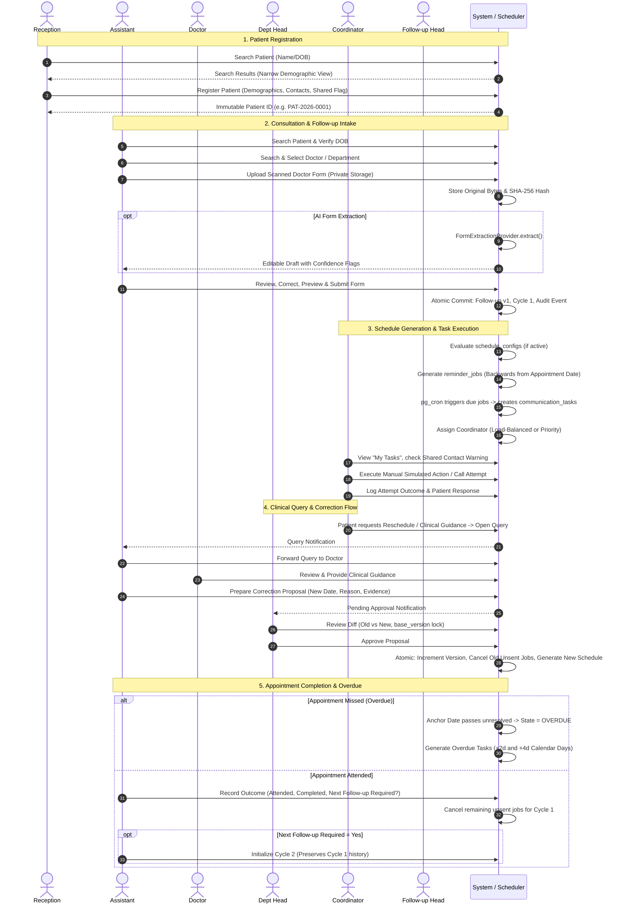
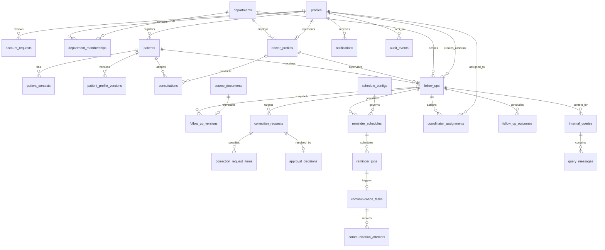

# Comprehensive Domain, Feature, Data Model, and API Specification Analysis

**Authoritative Source**: `c:\Users\ASUS\Desktop\Projects\dd\HOSPITAL_FOLLOWUP_BUILD_SPEC.md`  
**Explorer Agent**: `teamwork_explorer_survey_1`  
**Date**: 2026-10-30  
**Context**: Greenfield production-grade hospital patient-registration and follow-up continuity system.

---

## Executive Summary

The **Hospital Follow-up Continuity System** digitises doctor-completed follow-up forms, maintains an immutable and version-controlled patient/follow-up history, generates appointment-anchored reminder schedules, coordinates follow-up tasks across a centralized hospital-wide coordinator pool, and records attributable operational actions.

The system is explicitly **not a full Electronic Health Record (EHR)**. Doctors retain absolute clinical authority; Department Heads possess exclusive operational approval over clinical corrections and schedule changes; Coordinators execute communication tasks; Reception handles registration; and IT Administrators manage identity and security without clinical record access. AI is strictly assistive, requiring mandatory human review before any data submission.

---

## 1. Exhaustive Functional Features & Requirements Inventory

### 1.1 Public Landing & Account Access Management
1. **Public Institutional Landing Page (`/`)**:
   - Institutional hospital branding and concise system purpose description.
   - Primary **Login** call to action.
   - Secondary **Request a new account** call to action.
   - Concise privacy and security notice (no patient data or internal hospital metrics displayed publicly).
   - Fully responsive layout, high contrast, WCAG keyboard accessibility, clear loading and error feedback.

2. **Authentication Console (`/login`)**:
   - Email and password authentication backed exclusively by **Supabase Auth**.
   - Password visibility toggle and password-reset initiation (`/forgot-password`).
   - Anti-enumeration protection: Public error messages must be generic (e.g., "Invalid login credentials") and never reveal whether an email exists in the system.
   - Post-authentication verification: Server-side profile resolution loading role, department, and account status.
   - Fail-closed security rule: Users with status `invited`, `pending`, `suspended`, or `deactivated` must be denied access immediately, even if a valid Supabase Auth session exists. Role mismatches or missing profiles trigger an alert and redirect to a blocked state.
   - MFA enforcement: Mandatory Multi-Factor Authentication for `it_admin`; configured and recommended for all staff roles.

3. **Public Account Access Request (`/request-access`)**:
   - Public self-registration is explicitly prohibited in Supabase Auth (`supabase.auth.signUp` disabled).
   - Requesters submit an application containing:
     - Full Name
     - Hospital/Work Email (normalized to lowercase)
     - Employee/Staff Identifier (optional)
     - Requested Operational Role: Limited strictly to the 6 operational roles (`reception`, `assistant`, `doctor`, `department_head`, `coordinator`, `follow_up_head`). Requesters **cannot** request or select `it_admin`.
     - Department (required for clinical roles: Assistant, Doctor, Department Head).
     - Justification / Reason for access.
     - Explicit agreement to the hospital's account-use and privacy policies.
   - Server-side Zod validation, rejection of malformed or oversized payloads.
   - Bot protection (CAPTCHA) and IP/email rate limiting.
   - Idempotency / Duplicate prevention: Rejects repeated pending requests for the same normalized email.
   - Persistence: Saved as `pending` in `account_requests` with a unique request ID and timestamps.
   - In-app notification delivered to IT Head queue. Email notification sent only if external SMTP is configured.
   - Anti-enumeration status check: Confirmation gives a private request reference or secure status token (`/request-access/status?token=<hash>`), preventing lookup by email alone.

4. **IT Account Approval & Identity Lifecycle (`/it-admin`)**:
   - IT Admin request queue supporting filters: `pending`, `approved`, `rejected`, `expired`, `cancelled`.
   - IT Admin review interface displaying requester details, requested role, department, justification, and request events.
   - Actionable decisions:
     - **Approve**: IT Head confirms/assigns final role and department. Triggers server-side Supabase Auth Admin API (`inviteUserByEmail`). Generates an invite token/link. Mapped profile created with status `invited`. No plaintext temporary passwords generated, displayed, or emailed.
     - **Reject**: Requires a mandatory justification; updates status to `rejected`; no Auth account is created.
     - **Request Clarification**: Records query event in `account_request_events`.
   - Concurrency & Race Condition Protection: Conditional update transactions ensure that if two admins review simultaneously, only one decision commits.
   - Invite Acceptance (`/invite/accept`): Token verified server-side; user sets their secure password; profile status transitions from `invited` to `active`.
   - Account Lifecycle Operations:
     - Suspend / Unsuspend: Temporarily halts session and RLS access.
     - Deactivate: Revokes all active sessions, bans Auth account, marks profile `deactivated`.
     - Reactivate: Restores active state under identical UUID without erasing historical attribution.
     - Reassignment: Audited modification of role or department membership.

---

### 1.2 Operational Dashboards & Workspaces

#### 1. Reception Workspace (`/reception`)
- **Patient Search**: Pre-registration search using name, patient ID, and approved demographic fields via a narrow server-side RPC (exposing minimum distinguishing information, e.g., name and DOB).
- **Duplicate-Match Resolution**: Prevents auto-selection if multiple matches exist; prompts staff for extra verification.
- **Patient Registration Form**: Full Name, DOB, primary contact (phone/email), alternate contact, contact verification status, shared-contact flag, registration actor and timestamp.
- **Identity Generation**: Backend generates a stable, unique, immutable `patient_id`.
- **Shared Contact Guardrail**: Prominently flags shared phone numbers. Prohibits disclosure of clinical notes, severity, diagnosis, or prescription. Restricts contact language to approved non-sensitive phrasing.
- **Patient Summary**: Limited strictly to demographic and contact data; clinical notes and history are blocked.
- **Demographic Correction Request**: Reception submits change proposals with reason and supporting evidence; cannot directly mutate registered patient records.

#### 2. Doctor's Assistant Workspace (`/assistant`)
- **Patient Verification**: Search and verify patient identity against DOB.
- **Doctor Association**: Search and select doctor; validates doctor identity and department association.
- **Intake Modalities**: Manual data entry or physical paper form scan upload.
- **Document Management**: Scanned forms uploaded to private Supabase Storage (`source_documents`). Validates MIME type (PDF, JPEG, PNG), file size, and magic bytes. Quarantine path before association. Preserves exact raw file bytes and SHA-256 hash. Overwriting original scan is prohibited.
- **AI-Assisted OCR (Optional)**: Extracts text into draft fields via `FormExtractionProvider`. Highlights field-level confidence and flags uncertain items.
- **Mandatory Human Verification**: Assistant reviews and edits every single draft field prior to submission.
- **Follow-up Form Submission**:
  - Fields: Patient ID, Doctor ID, Follow-up Required (`true`/`false`), Severity (`Normal`, `Moderate`, `Severe`), Appointment Date (mandatory if follow-up required), Instructions/Notes, Source Document reference.
  - Validates appointment date against hospital timezone (`APP_TIME_ZONE`).
  - Atomic submission: Creates follow-up record, initial immutable version (`version 1`), document linkage, and audit event.
  - If follow-up required = `false`, no reminder schedule or jobs are generated.
- **Follow-up Lifecycle Management**:
  - Record patient attendance, completion status, and whether a new follow-up cycle is required.
  - Initiating a subsequent follow-up creates a brand-new cycle; past cycles remain immutable.
  - Prepares correction proposals and schedule modification requests (cannot directly edit submitted records).

#### 3. Doctor Workspace (`/doctor`)
- **Scoped Clinical Oversight**: Access restricted to follow-ups assigned to the doctor or explicitly authorized within their department. No cross-department browsing.
- **Record History**: Read-only view of submitted follow-up data, consultation notes, instructions, and version histories.
- **Correction Requests**: Propose corrections with reason and field changes; direct editing of submitted records is prevented.
- **Clinical Query Thread**: Receive queries forwarded by the Assistant; provide clinical guidance.
- **Reschedule / Refusal Reviews**: Evaluate coordinator-escalated patient requests (reschedule or refusal) and decide whether the clinical plan requires amendment.
- **Clinical Governance Boundary**: Clinical instructions in query threads do not mutate records directly; any changes must follow the formal proposal and Department Head approval pipeline.

#### 4. Department Head Workspace (`/department-head`)
- **Departmental Governance**: Scoped strictly to the head's assigned department.
- **Approval Queue**:
  - Side-by-side comparison of current values versus proposed values.
  - Review requester identity, justification, supporting evidence, target base version, and conflict/stale status.
- **Decision Execution**:
  - **Approve**: Verifies `base_version` matches current version under row locks (`FOR UPDATE`). Applies changes, increments version number, cancels superseded unsent reminder jobs, generates new schedule version, logs before/after audit states in a single transaction.
  - **Reject**: Requires a mandatory rejection reason; leaves active record and reminder jobs untouched; dispatches notification to requester.
- **Stale Version Handling**: If an approval updates a record, concurrent pending proposals for that record are marked stale and flagged for re-review.
- **Demographic Correction Approval**: Reviews patient demographic change proposals originating from Reception or Assistant.

#### 5. Follow-up Coordinator Workspace (`/coordinator`)
- **"My Tasks" Queue**: Filterable and searchable views for `Due`, `Overdue`, `Upcoming`, and `Completed` communication tasks assigned to the coordinator.
- **Patient Contact Context**: Minimum necessary demographic details; prominent warning banner if contact number is flagged as shared.
- **Manual Simulated Confirmation**:
  - Action to record manual execution of text reminders.
  - UI requirement: Explicitly display **"Manually confirmed / simulated — not provider verified"**.
- **Call Attempt & Outcome Logging**:
  - Call Attempt Outcomes: `Answered`, `No answer`, `Unreachable`, `Callback requested`, `Other`.
  - Patient Response Classification: `Appointment confirmed`, `Rescheduling requested`, `Follow-up declined`, `Clinical guidance needed`, `Other`.
- **Query Escalation**: Direct in-app query escalation to the linked Assistant for clinical guidance or rescheduling needs.
- **Prohibitions**: Cannot edit clinical notes, alter severity, modify prescriptions, change schedules directly, or mark clinical closure.

#### 6. Follow-up Head Workspace (`/follow-up-head`)
- **Central Coordinator Pool Management**: Manages hospital-wide coordinator staffing and task allocations.
- **Operational Metrics & Workload Dashboard**:
  - Live metric tiles: Active assignments, due tasks, overdue tasks, pending tasks, coordinator availability, individual workload counts, completions, unassigned exception queue, and priority task statuses.
- **Exception Queue**: Unassigned tasks remain permanently visible until claimed or assigned; tasks never silently drop.
- **Priority Work Allocation**:
  - Manually assign priority tasks to specific coordinators.
  - High workload warning: Triggers if coordinator load exceeds threshold. Explicit override requires a mandatory justification and creates an audit event.
  - Automatic pool return: When priority task completes, coordinator automatically returns to standard load-balanced pool, and Follow-up Head is notified.
- **Authorised Reassignment**: Manages reassignment when a coordinator is unavailable, on leave, or deactivated. Preserves historical read-only access for former handlers.
- **Clinical Privacy Boundary**: Prohibited from viewing unrestricted clinical notes, prescriptions, or diagnosis details. Information requests must route via Assistant → Doctor.

#### 7. IT Head / IT Admin Console (`/it-admin`)
- **Account Management**: Request queue, decision processing, user invitations, profile activations, suspension, deactivation, and reactivation.
- **System Administration**: Department management, role assignments, duplicate identity reconciliation.
- **Security & Audit Logs**: Read-only inspection of security events, login failures, authorization denials, and system audit logs.
- **Strict Clinical Wall**: Zero routine access to patient registrations or clinical records. Emergency intervention requires explicit, time-limited, audited authorization from a Department Head.

---

## 2. Core Business Workflows, Patient Journey, State Transitions, and Business Rules

### 2.1 Complete End-to-End Patient Journey



---

### 2.2 Formal State Machines

#### 1. Account Request State Machine
```text
                  ┌──────────────────────┐
                  │       PENDING        │
                  └──────────┬───────────┘
                             │
            ┌────────────────┼────────────────┐
            ▼                ▼                ▼
     ┌─────────────┐  ┌─────────────┐  ┌─────────────┐
     │  APPROVED   │  │  REJECTED   │  │  EXPIRED /  │
     └──────┬──────┘  └─────────────┘  │  CANCELLED  │
            │                          └─────────────┘
            ▼
     (Auth Invite Sent)
```
- **Transitions**:
  - `pending` → `approved`: IT Admin approves, assigns role/department; triggers Auth invite.
  - `pending` → `rejected`: IT Admin rejects with mandatory reason.
  - `pending` → `expired` / `cancelled`: Expired by policy or cancelled by requester.

#### 2. User Profile Lifecycle
```text
  ┌───────────┐      Invite Accepted      ┌───────────┐
  │  INVITED  ├──────────────────────────►│  ACTIVE   │◄──────────────┐
  └───────────┘      & Password Set       └─────┬─────┘               │
                                                │                     │
                                   Suspend      │   Reactivate        │
                                   or Deactivate│   / Unsuspend       │
                                                ▼                     │
                                         ┌─────────────┐              │
                                         │ SUSPENDED / ├──────────────┘
                                         │ DEACTIVATED │
                                         └─────────────┘
```

#### 3. Follow-up Lifecycle State Machine
```text
 ┌─────────┐   Submit    ┌───────────┐   Schedule Enabled   ┌──────────┐
 │  DRAFT  ├────────────►│ SUBMITTED ├─────────────────────►│  ACTIVE  │
 └─────────┘             └───────────┘                      └───┬──────┘
                                                                │
                            ┌───────────────────────────────────┤
                            │                                   │
               Anchor Date Passed Unresolved                    │ Attendance /
                            │                                   │ Completion
                            ▼                                   ▼
                     ┌─────────────┐                     ┌─────────────┐
                     │   OVERDUE   ├────────────────────►│  COMPLETED  │
                     └─────────────┘  Resolve & Attend   └─────────────┘
                            │
                            │ (Authorised Cancellation Path - OPEN)
                            ▼
                     ┌─────────────┐
                     │  CANCELLED  │
                     └─────────────┘
```

#### 4. Correction Request State Machine
```text
                  ┌──────────────────────┐
                  │       PENDING        │
                  └──────────┬───────────┘
                             │
            ┌────────────────┼────────────────┐
            ▼                ▼                ▼
     ┌─────────────┐  ┌─────────────┐  ┌─────────────┐
     │  APPROVED   │  │  REJECTED   │  │    STALE    │
     └─────────────┘  └─────────────┘  └─────────────┘
```
- `stale` condition: When a competing proposal for the same follow-up is approved, the base version advances. Unapproved proposals referencing the previous `base_version` become `stale` and require renewed review.

#### 5. Reminder Job & Communication Task Lifecycle
```text
  ┌─────────┐   Cron Lock    ┌────────────┐   Success   ┌───────────┐
  │ PENDING ├───────────────►│ PROCESSING ├────────────►│ COMPLETED │
  └────┬────┘                └─────┬──────┘             └───────────┘
       │                           │ Retry < 3
       │ Superseded                ▼
       │ by reschedule       ┌────────────┐
       ▼                     │   FAILED   │
  ┌───────────┐              └────────────┘
  │ CANCELLED │
  └───────────┘
```

---

### 2.3 Strict Domain Business Rules

1. **Non-Negotiable Human Accountability**: AI is an administrative drafting assistant. AI can never directly commit clinical records, adjust severity, approve corrections, or initiate patient communications.
2. **Submitted Record Immutability**: Once an Assistant submits a follow-up record, it is immutable (`follow_up_versions`). Direct row updates of clinical fields are prohibited. All modifications require an approved `correction_request`.
3. **Department Head Authority**: Department Heads approve corrections and schedule changes exclusively within their department. IT Admins, Doctors, and Assistants cannot approve clinical corrections.
4. **Permanent Attribution**: User deactivation disables authentication and access, but historical record attribution, audit events, and activity logs remain permanently intact. Deleting user records is prohibited.
5. **Truthful Communication Records**: Simulated actions must be labelled **"Manually confirmed / simulated — not provider verified"**. No fake provider delivery statuses ("delivered", "read") may be stored.
6. **Appointment-Anchored Scheduling**: Pre-appointment reminders count backwards from the appointment anchor date. Intervals shorten as the date approaches. First reminder must always be a text task.
7. **Severity Mix Rule**: Severity changes the text-to-call ratio, not the date spacing formula.
8. **Overdue Reminder Rule**: If appointment date passes unresolved, status becomes `OVERDUE`. Exactly two text tasks are created: +2 calendar days and +4 calendar days in the hospital's local timezone. No further automated reminders.
9. **Fail-Closed Authorization**: If a profile is inactive, role is missing, or department context is invalid, the request is denied immediately.
10. **Shared Contact Privacy**: A shared contact flag blocks disclosure of diagnosis, severity, notes, and prescriptions. Contact is restricted to generic institutional identity.

---

## 3. Data Models, Entities, Relationships, Schemas, and Fields

### 3.1 Entity Relationship Diagram



---

### 3.2 Exhaustive Table Schemas & Constraints

#### 1. Identity & Organization Tables
- **`profiles`**:
  - `id` (UUID, PK, FK to `auth.users.id` ON DELETE RESTRICT)
  - `display_name` (text, NOT NULL)
  - `role` (enum: `reception`, `assistant`, `doctor`, `department_head`, `coordinator`, `follow_up_head`, `it_admin`, NOT NULL)
  - `status` (enum: `invited`, `active`, `suspended`, `deactivated`, NOT NULL, DEFAULT `invited`)
  - `department_id` (UUID, nullable, FK to `departments.id`)
  - `created_at` (timestamptz, DEFAULT now())
  - `updated_at` (timestamptz, DEFAULT now())
- **`account_requests`**:
  - `id` (UUID, PK, DEFAULT gen_random_uuid())
  - `full_name` (text, NOT NULL)
  - `email` (text, NOT NULL, CHECK (email = lower(email)))
  - `employee_id` (text, nullable)
  - `requested_role` (enum excluding `it_admin`, NOT NULL)
  - `department_id` (UUID, nullable, FK to `departments.id`)
  - `reason` (text, NOT NULL)
  - `privacy_accepted` (boolean, NOT NULL, CHECK (privacy_accepted = true))
  - `status` (enum: `pending`, `approved`, `rejected`, `expired`, `cancelled`, DEFAULT `pending`)
  - `status_token_hash` (text, NOT NULL, UNIQUE)
  - `reviewed_by` (UUID, nullable, FK to `profiles.id`)
  - `reviewed_at` (timestamptz, nullable)
  - `decision_reason` (text, nullable)
  - `auth_user_id` (UUID, nullable, FK to `auth.users.id`)
  - `created_at` (timestamptz, DEFAULT now())
  - `updated_at` (timestamptz, DEFAULT now())
- **`account_request_events`**:
  - `id` (UUID, PK, DEFAULT gen_random_uuid())
  - `request_id` (UUID, NOT NULL, FK to `account_requests.id` ON DELETE CASCADE)
  - `actor_id` (UUID, nullable, FK to `profiles.id`)
  - `event_type` (text, NOT NULL) — e.g., `SUBMITTED`, `REVIEWED`, `INVITE_SENT`, `INVITE_ACCEPTED`, `REJECTED`
  - `payload` (jsonb, NOT NULL, DEFAULT '{}'::jsonb)
  - `created_at` (timestamptz, DEFAULT now())
- **`departments`**:
  - `id` (UUID, PK, DEFAULT gen_random_uuid())
  - `code` (text, NOT NULL, UNIQUE) — e.g., `CARDIO`, `ORTHO`, `PED`
  - `name` (text, NOT NULL)
  - `is_active` (boolean, NOT NULL, DEFAULT true)
  - `created_at` (timestamptz, DEFAULT now())
- **`department_memberships`**:
  - `id` (UUID, PK, DEFAULT gen_random_uuid())
  - `user_id` (UUID, NOT NULL, FK to `profiles.id` ON DELETE CASCADE)
  - `department_id` (UUID, NOT NULL, FK to `departments.id` ON DELETE CASCADE)
  - `role` (text, NOT NULL)
  - `is_primary` (boolean, NOT NULL, DEFAULT true)
  - `is_active` (boolean, NOT NULL, DEFAULT true)
  - `created_at` (timestamptz, DEFAULT now())
  - CONSTRAINT: `unique_active_user_dept` UNIQUE (`user_id`, `department_id`)
- **`doctor_profiles`**:
  - `id` (UUID, PK, DEFAULT gen_random_uuid())
  - `user_id` (UUID, NOT NULL, UNIQUE, FK to `profiles.id` ON DELETE RESTRICT)
  - `doctor_id` (text, NOT NULL, UNIQUE) — stable hospital identifier (e.g., `DOC-0042`)
  - `specialty` (text, NOT NULL)
  - `department_id` (UUID, NOT NULL, FK to `departments.id`)
  - `created_at` (timestamptz, DEFAULT now())

#### 2. Patient & Consultation Tables
- **`patients`**:
  - `id` (UUID, PK, DEFAULT gen_random_uuid())
  - `patient_id` (text, NOT NULL, UNIQUE) — generated stable identity (e.g., `PAT-2026-XXXX`)
  - `full_name` (text, NOT NULL)
  - `date_of_birth` (date, NOT NULL)
  - `gender` (text, nullable)
  - `registered_by` (UUID, NOT NULL, FK to `profiles.id`)
  - `created_at` (timestamptz, DEFAULT now())
  - `updated_at` (timestamptz, DEFAULT now())
- **`patient_contacts`**:
  - `id` (UUID, PK, DEFAULT gen_random_uuid())
  - `patient_id` (UUID, NOT NULL, FK to `patients.id` ON DELETE CASCADE)
  - `contact_type` (enum: `phone`, `email`, NOT NULL)
  - `contact_value` (text, NOT NULL)
  - `is_primary` (boolean, NOT NULL, DEFAULT true)
  - `verification_status` (enum: `unverified`, `verified`, DEFAULT `unverified`)
  - `is_shared` (boolean, NOT NULL, DEFAULT false)
  - `notes` (text, nullable)
  - `created_at` (timestamptz, DEFAULT now())
  - `updated_at` (timestamptz, DEFAULT now())
- **`patient_profile_versions`**:
  - `id` (UUID, PK, DEFAULT gen_random_uuid())
  - `patient_id` (UUID, NOT NULL, FK to `patients.id` ON DELETE CASCADE)
  - `version_number` (integer, NOT NULL)
  - `snapshot` (jsonb, NOT NULL)
  - `changed_by` (UUID, NOT NULL, FK to `profiles.id`)
  - `reason` (text, NOT NULL)
  - `approved_by` (UUID, NOT NULL, FK to `profiles.id`)
  - `created_at` (timestamptz, DEFAULT now())
  - UNIQUE (`patient_id`, `version_number`)
- **`consultations`**:
  - `id` (UUID, PK, DEFAULT gen_random_uuid())
  - `patient_id` (UUID, NOT NULL, FK to `patients.id`)
  - `doctor_id` (UUID, NOT NULL, FK to `doctor_profiles.id`)
  - `department_id` (UUID, NOT NULL, FK to `departments.id`)
  - `consultation_date` (date, NOT NULL)
  - `clinical_summary` (text, nullable)
  - `created_at` (timestamptz, DEFAULT now())

#### 3. Follow-up & Document Tables
- **`follow_ups`**:
  - `id` (UUID, PK, DEFAULT gen_random_uuid())
  - `patient_id` (UUID, NOT NULL, FK to `patients.id`)
  - `doctor_id` (UUID, NOT NULL, FK to `doctor_profiles.id`)
  - `department_id` (UUID, NOT NULL, FK to `departments.id`)
  - `assistant_id` (UUID, NOT NULL, FK to `profiles.id`)
  - `current_version` (integer, NOT NULL, DEFAULT 1)
  - `follow_up_required` (boolean, NOT NULL)
  - `severity` (enum: `normal`, `moderate`, `severe`, NOT NULL)
  - `appointment_date` (date, nullable)
  - `instructions` (text, nullable)
  - `status` (enum: `draft`, `submitted`, `active`, `overdue`, `completed`, `cancelled`, NOT NULL, DEFAULT `draft`)
  - `cycle_number` (integer, NOT NULL, DEFAULT 1)
  - `created_at` (timestamptz, DEFAULT now())
  - `updated_at` (timestamptz, DEFAULT now())
  - CHECK (follow_up_required = false OR appointment_date IS NOT NULL)
- **`follow_up_versions`**:
  - `id` (UUID, PK, DEFAULT gen_random_uuid())
  - `follow_up_id` (UUID, NOT NULL, FK to `follow_ups.id` ON DELETE CASCADE)
  - `version_number` (integer, NOT NULL)
  - `snapshot` (jsonb, NOT NULL)
  - `source_document_id` (UUID, nullable, FK to `source_documents.id`)
  - `created_by` (UUID, NOT NULL, FK to `profiles.id`)
  - `created_at` (timestamptz, DEFAULT now())
  - UNIQUE (`follow_up_id`, `version_number`)
- **`source_documents`**:
  - `id` (UUID, PK, DEFAULT gen_random_uuid())
  - `follow_up_id` (UUID, nullable, FK to `follow_ups.id` ON DELETE SET NULL)
  - `storage_path` (text, NOT NULL, UNIQUE)
  - `file_name` (text, NOT NULL)
  - `mime_type` (text, NOT NULL, CHECK (mime_type IN ('application/pdf', 'image/jpeg', 'image/png')))
  - `file_size_bytes` (bigint, NOT NULL)
  - `sha256_hash` (text, NOT NULL)
  - `uploaded_by` (UUID, NOT NULL, FK to `profiles.id`)
  - `created_at` (timestamptz, DEFAULT now())
- **`correction_requests`**:
  - `id` (UUID, PK, DEFAULT gen_random_uuid())
  - `follow_up_id` (UUID, NOT NULL, FK to `follow_ups.id` ON DELETE CASCADE)
  - `base_version` (integer, NOT NULL)
  - `requester_id` (UUID, NOT NULL, FK to `profiles.id`)
  - `reason` (text, NOT NULL)
  - `evidence_url` (text, nullable)
  - `status` (enum: `pending`, `approved`, `rejected`, `stale`, DEFAULT `pending`)
  - `reviewed_by` (UUID, nullable, FK to `profiles.id`)
  - `reviewed_at` (timestamptz, nullable)
  - `decision_reason` (text, nullable)
  - `created_at` (timestamptz, DEFAULT now())
  - `updated_at` (timestamptz, DEFAULT now())
- **`correction_request_items`**:
  - `id` (UUID, PK, DEFAULT gen_random_uuid())
  - `correction_request_id` (UUID, NOT NULL, FK to `correction_requests.id` ON DELETE CASCADE)
  - `field_name` (text, NOT NULL)
  - `original_value` (text, NOT NULL)
  - `proposed_value` (text, NOT NULL)
  - `is_stale` (boolean, NOT NULL, DEFAULT false)
  - `created_at` (timestamptz, DEFAULT now())
- **`approval_decisions`**:
  - `id` (UUID, PK, DEFAULT gen_random_uuid())
  - `target_type` (text, NOT NULL) — e.g. `follow_up_correction`, `patient_demographic`
  - `target_id` (UUID, NOT NULL)
  - `approver_id` (UUID, NOT NULL, FK to `profiles.id`)
  - `decision` (enum: `approved`, `rejected`, NOT NULL)
  - `reason` (text, NOT NULL)
  - `target_version` (integer, NOT NULL)
  - `created_at` (timestamptz, DEFAULT now())

#### 4. Scheduling, Tasks & Communications Tables
- **`schedule_configs`**:
  - `id` (UUID, PK, DEFAULT gen_random_uuid())
  - `version` (integer, NOT NULL, UNIQUE)
  - `strategy_name` (text, NOT NULL)
  - `parameters` (jsonb, NOT NULL)
  - `is_active` (boolean, NOT NULL, DEFAULT false)
  - `daytime_window_start` (time, nullable)
  - `daytime_window_end` (time, nullable)
  - `timezone` (text, NOT NULL, DEFAULT 'Asia/Kolkata')
  - `approved_by` (UUID, nullable, FK to `profiles.id`)
  - `created_at` (timestamptz, DEFAULT now())
- **`reminder_schedules`**:
  - `id` (UUID, PK, DEFAULT gen_random_uuid())
  - `follow_up_id` (UUID, NOT NULL, FK to `follow_ups.id` ON DELETE CASCADE)
  - `schedule_version` (integer, NOT NULL)
  - `config_version` (integer, NOT NULL, FK to `schedule_configs.version`)
  - `anchor_date` (date, NOT NULL)
  - `status` (enum: `active`, `superseded`, `cancelled`, DEFAULT `active`)
  - `created_at` (timestamptz, DEFAULT now())
  - UNIQUE (`follow_up_id`, `schedule_version`)
- **`reminder_jobs`**:
  - `id` (UUID, PK, DEFAULT gen_random_uuid())
  - `follow_up_id` (UUID, NOT NULL, FK to `follow_ups.id` ON DELETE CASCADE)
  - `schedule_id` (UUID, NOT NULL, FK to `reminder_schedules.id` ON DELETE CASCADE)
  - `task_type` (enum: `text`, `call`, NOT NULL)
  - `scheduled_at` (timestamptz, NOT NULL)
  - `timezone` (text, NOT NULL)
  - `status` (enum: `pending`, `processing`, `completed`, `failed`, `cancelled`, DEFAULT `pending`)
  - `retry_count` (integer, NOT NULL, DEFAULT 0, CHECK (retry_count <= 3))
  - `idempotency_key` (text, NOT NULL, UNIQUE)
  - `executed_at` (timestamptz, nullable)
  - `created_at` (timestamptz, DEFAULT now())
  - `updated_at` (timestamptz, DEFAULT now())
- **`communication_tasks`**:
  - `id` (UUID, PK, DEFAULT gen_random_uuid())
  - `follow_up_id` (UUID, NOT NULL, FK to `follow_ups.id` ON DELETE CASCADE)
  - `reminder_job_id` (UUID, nullable, FK to `reminder_jobs.id`)
  - `method` (enum: `text`, `call`, NOT NULL)
  - `assigned_coordinator_id` (UUID, nullable, FK to `profiles.id`)
  - `status` (enum: `pending`, `assigned`, `in_progress`, `completed`, `escalated`, `cancelled`, DEFAULT `pending`)
  - `due_at` (timestamptz, NOT NULL)
  - `priority` (enum: `standard`, `priority`, DEFAULT `standard`)
  - `created_at` (timestamptz, DEFAULT now())
  - `updated_at` (timestamptz, DEFAULT now())
- **`communication_attempts`**:
  - `id` (UUID, PK, DEFAULT gen_random_uuid())
  - `communication_task_id` (UUID, NOT NULL, FK to `communication_tasks.id` ON DELETE CASCADE)
  - `actor_id` (UUID, NOT NULL, FK to `profiles.id`)
  - `attempt_type` (enum: `manual_simulated_send`, `call_attempt`, NOT NULL)
  - `call_outcome` (enum: `answered`, `no_answer`, `unreachable`, `callback_requested`, `other`, nullable)
  - `patient_response` (enum: `appointment_confirmed`, `rescheduling_requested`, `follow_up_declined`, `clinical_guidance_needed`, `other`, nullable)
  - `notes` (text, nullable)
  - `created_at` (timestamptz, DEFAULT now())
- **`coordinator_assignments`**:
  - `id` (UUID, PK, DEFAULT gen_random_uuid())
  - `follow_up_id` (UUID, NOT NULL, FK to `follow_ups.id` ON DELETE CASCADE)
  - `communication_task_id` (UUID, nullable, FK to `communication_tasks.id`)
  - `coordinator_id` (UUID, NOT NULL, FK to `profiles.id`)
  - `assigned_by` (UUID, nullable, FK to `profiles.id`)
  - `assignment_type` (enum: `automated_load_balanced`, `manual_priority`, `reassignment`, NOT NULL)
  - `previous_coordinator_id` (UUID, nullable, FK to `profiles.id`)
  - `reason` (text, nullable)
  - `effective_at` (timestamptz, DEFAULT now())
  - `is_active` (boolean, NOT NULL, DEFAULT true)
- **`coordinator_workload_events`**:
  - `id` (UUID, PK, DEFAULT gen_random_uuid())
  - `coordinator_id` (UUID, NOT NULL, FK to `profiles.id`)
  - `event_type` (text, NOT NULL) — `TASK_ASSIGNED`, `TASK_COMPLETED`, `TASK_REASSIGNED`
  - `delta` (integer, NOT NULL) — `+1` or `-1`
  - `task_id` (UUID, nullable, FK to `communication_tasks.id`)
  - `created_at` (timestamptz, DEFAULT now())
- **`follow_up_outcomes`**:
  - `id` (UUID, PK, DEFAULT gen_random_uuid())
  - `follow_up_id` (UUID, NOT NULL, FK to `follow_ups.id` ON DELETE CASCADE)
  - `attendance_status` (enum: `attended`, `missed`, `cancelled`, NOT NULL)
  - `completion_status` (enum: `completed`, `incomplete`, NOT NULL)
  - `next_follow_up_required` (boolean, NOT NULL)
  - `next_appointment_date` (date, nullable)
  - `notes` (text, nullable)
  - `recorded_by` (UUID, NOT NULL, FK to `profiles.id`)
  - `recorded_at` (timestamptz, DEFAULT now())

#### 5. Collaboration, Notifications, Audit & AI Tables
- **`internal_queries`**:
  - `id` (UUID, PK, DEFAULT gen_random_uuid())
  - `follow_up_id` (UUID, NOT NULL, FK to `follow_ups.id` ON DELETE CASCADE)
  - `title` (text, NOT NULL)
  - `status` (enum: `open`, `waiting_for_doctor`, `answered`, `closed`, DEFAULT `open`)
  - `created_by` (UUID, NOT NULL, FK to `profiles.id`)
  - `created_at` (timestamptz, DEFAULT now())
  - `updated_at` (timestamptz, DEFAULT now())
- **`query_messages`**:
  - `id` (UUID, PK, DEFAULT gen_random_uuid())
  - `query_id` (UUID, NOT NULL, FK to `internal_queries.id` ON DELETE CASCADE)
  - `sender_id` (UUID, NOT NULL, FK to `profiles.id`)
  - `recipient_id` (UUID, nullable, FK to `profiles.id`)
  - `body` (text, NOT NULL)
  - `forwarded_from_id` (UUID, nullable, FK to `query_messages.id`)
  - `created_at` (timestamptz, DEFAULT now())
- **`notifications`**:
  - `id` (UUID, PK, DEFAULT gen_random_uuid())
  - `recipient_id` (UUID, NOT NULL, FK to `profiles.id` ON DELETE CASCADE)
  - `event_type` (text, NOT NULL)
  - `message` (text, NOT NULL)
  - `target_type` (text, NOT NULL)
  - `target_id` (UUID, NOT NULL)
  - `is_read` (boolean, NOT NULL, DEFAULT false)
  - `read_at` (timestamptz, nullable)
  - `created_at` (timestamptz, DEFAULT now())
- **`audit_events`**:
  - `id` (UUID, PK, DEFAULT gen_random_uuid())
  - `actor_id` (UUID, nullable, FK to `profiles.id`)
  - `actor_role` (text, NOT NULL)
  - `action` (text, NOT NULL)
  - `target_type` (text, NOT NULL)
  - `target_id` (UUID, NOT NULL)
  - `request_id` (text, nullable)
  - `before_state` (jsonb, nullable)
  - `after_state` (jsonb, nullable)
  - `outcome` (text, NOT NULL) — `SUCCESS`, `DENIED`, `FAILED`
  - `reason` (text, nullable)
  - `ip_address` (text, nullable)
  - `user_agent` (text, nullable)
  - `created_at` (timestamptz, DEFAULT now())
  - (RLS: Append-only; UPDATE and DELETE permanently REVOKED)
- **`ai_assistance_events`**:
  - `id` (UUID, PK, DEFAULT gen_random_uuid())
  - `provider` (text, NOT NULL)
  - `model_id` (text, NOT NULL)
  - `model_version` (text, NOT NULL)
  - `purpose` (text, NOT NULL)
  - `input_reference` (text, NOT NULL)
  - `input_hash` (text, NOT NULL)
  - `confidence_scores` (jsonb, NOT NULL)
  - `warnings` (text[], NOT NULL, DEFAULT '{}')
  - `human_reviewer_id` (UUID, NOT NULL, FK to `profiles.id`)
  - `corrections_applied` (jsonb, NOT NULL)
  - `outcome` (text, NOT NULL)
  - `created_at` (timestamptz, DEFAULT now())

---

## 4. API Contracts, Endpoints, Request/Response Structures, and Error Codes

All state-mutating operations are implemented via Next.js Server Actions or authenticated Route Handlers executing in request-scoped cookies with server-side identity verification.

### 4.1 Standardized Response & Error Contracts

#### Success Envelope
```json
{
  "success": true,
  "data": { ... }
}
```

#### Error Envelope
```json
{
  "success": false,
  "error": {
    "code": "STALE_VERSION_CONFLICT",
    "message": "The follow-up record has been updated since this proposal was drafted.",
    "details": {
      "expectedVersion": 2,
      "currentVersion": 3
    }
  }
}
```

#### Global Error Code Dictionary
| Code | HTTP Status | Description |
|---|---|---|
| `UNAUTHENTICATED` | 401 | Missing or invalid Supabase session cookie. |
| `ACCOUNT_INACTIVE` | 403 | User profile status is `invited`, `suspended`, or `deactivated`. |
| `FORBIDDEN_ROLE` | 403 | User role is not permitted to execute this action. |
| `DEPARTMENT_MISMATCH` | 403 | Action targets a record outside the user's assigned department. |
| `NOT_FOUND` | 404 | Target entity does not exist or user lacks permission to see it. |
| `VALIDATION_FAILED` | 422 | Zod schema validation rejected the request payload. |
| `RATE_LIMITED` | 429 | Request threshold exceeded on rate-limited endpoints. |
| `STALE_VERSION_CONFLICT` | 409 | Proposed change was based on an outdated record version. |
| `CONCURRENT_MODIFICATION` | 409 | Concurrency race condition; another admin/user committed first. |
| `IDEMPOTENCY_VIOLATION` | 409 | Duplicate job key or submission idempotency clash. |
| `UNAPPROVED_SCHEDULE_CONFIG` | 400 | Scheduling requested but schedule strategy is in `needs_configuration`. |
| `INTERNAL_ERROR` | 500 | Unhandled server error (sanitized diagnostics, logged securely). |

---

### 4.2 Endpoint & Server Action Specifications

#### 1. Identity & Access Requests
- **`POST /api/access-requests`**
  - **Auth**: Public (Anonymous) with CAPTCHA and Rate Limiter.
  - **Request Body**:
    ```json
    {
      "fullName": "Dr. Sarah Khan",
      "email": "sarah.khan@cityhospital.org",
      "employeeId": "EMP-8831",
      "requestedRole": "doctor",
      "departmentId": "48bf33a4-9271-464e-a128-4efbe0f40d82",
      "reason": "Joined Cardiology department as visiting consultant.",
      "privacyAccepted": true,
      "captchaToken": "token-string"
    }
    ```
  - **Response (201 Created)**:
    ```json
    {
      "success": true,
      "data": {
        "requestId": "90e0b355-6674-4b53-9d41-c1bc6b2b528a",
        "statusToken": "sec_tok_f8a92...",
        "message": "Your account request has been submitted for IT Head review."
      }
    }
    ```
- **`GET /api/access-requests/status?token=<hash>`**
  - **Auth**: Public anti-enumeration token.
  - **Response (200 OK)**:
    ```json
    {
      "success": true,
      "data": {
        "status": "pending",
        "submittedAt": "2026-10-30T02:00:00Z"
      }
    }
    ```
- **`POST /api/admin/access-requests/[id]/decide`**
  - **Auth**: `it_admin` only.
  - **Request Body**:
    ```json
    {
      "decision": "approve", // "approve" | "reject" | "clarify"
      "finalRole": "doctor",
      "finalDepartmentId": "48bf33a4-9271-464e-a128-4efbe0f40d82",
      "reason": "Credentials verified against medical board records."
    }
    ```
  - **Response (200 OK)**:
    ```json
    {
      "success": true,
      "data": {
        "requestId": "90e0b355-6674-4b53-9d41-c1bc6b2b528a",
        "status": "approved",
        "profileId": "a90184ce-d0c3-42e7-91a5-8ceeeea9e421",
        "inviteStatus": "sent"
      }
    }
    ```
- **`POST /api/admin/users/[id]/lifecycle`**
  - **Auth**: `it_admin` only.
  - **Request Body**:
    ```json
    {
      "action": "deactivate", // "suspend" | "activate" | "deactivate"
      "reason": "Staff member contract ended."
    }
    ```

#### 2. Patient Registration
- **`POST /api/patients/search` (RPC)**
  - **Auth**: `reception`, `assistant`.
  - **Request Body**:
    ```json
    {
      "query": "Aarav Sharma",
      "dateOfBirth": "1988-04-12"
    }
    ```
  - **Response (200 OK)**: Narrow results without clinical details.
    ```json
    {
      "success": true,
      "data": [
        {
          "patientId": "PAT-2026-0041",
          "fullName": "Aarav Sharma",
          "dateOfBirth": "1988-04-12",
          "primaryPhoneMasked": "+91 ***** **421"
        }
      ]
    }
    ```
- **`POST /api/patients`**
  - **Auth**: `reception` only.
  - **Request Body**:
    ```json
    {
      "fullName": "Priya Nair",
      "dateOfBirth": "1994-08-23",
      "gender": "female",
      "contacts": [
        {
          "type": "phone",
          "value": "+919876543210",
          "isPrimary": true,
          "isShared": true,
          "verificationStatus": "verified"
        }
      ]
    }
    ```
  - **Response (201 Created)**:
    ```json
    {
      "success": true,
      "data": {
        "id": "c1f73b18-b2ef-4573-80e9-b5a947c617b0",
        "patientId": "PAT-2026-0109"
      }
    }
    ```

#### 3. Follow-up Intake & Submission
- **`POST /api/documents/upload-ticket`**
  - **Auth**: `assistant` only.
  - **Request Body**:
    ```json
    {
      "fileName": "doctor_followup_slip.pdf",
      "mimeType": "application/pdf",
      "fileSizeBytes": 450200,
      "sha256": "e3b0c44298fc1c149afbf4c8996fb92427ae41e4649b934ca495991b7852b855"
    }
    ```
  - **Response (200 OK)**:
    ```json
    {
      "success": true,
      "data": {
        "storagePath": "quarantine/2026-10-30/slip_abc123.pdf",
        "signedUploadUrl": "https://<supabase-storage-url>/upload/..."
      }
    }
    ```
- **`POST /api/follow-ups/submit`**
  - **Auth**: `assistant` only.
  - **Request Body**:
    ```json
    {
      "patientId": "c1f73b18-b2ef-4573-80e9-b5a947c617b0",
      "doctorId": "d3810f99-4c1d-40e1-b4ec-9e87515a2cc1",
      "followUpRequired": true,
      "severity": "moderate",
      "appointmentDate": "2026-11-20",
      "instructions": "Check blood pressure twice daily; bring log.",
      "sourceDocumentId": "50e4b85c-1644-42ea-a9a7-96a9926c043e"
    }
    ```
  - **Response (201 Created)**:
    ```json
    {
      "success": true,
      "data": {
        "followUpId": "1a69a032-cb66-41f2-9596-f947b1981180",
        "version": 1,
        "status": "active"
      }
    }
    ```

#### 4. Corrections & Department Head Approvals
- **`POST /api/follow-ups/[id]/corrections`**
  - **Auth**: `assistant`, `doctor`.
  - **Request Body**:
    ```json
    {
      "baseVersion": 1,
      "reason": "Doctor corrected follow-up date due to lab report schedule.",
      "evidenceUrl": "quarantine/evidence_slip.png",
      "changes": [
        {
          "fieldName": "appointment_date",
          "originalValue": "2026-11-20",
          "proposedValue": "2026-11-27"
        }
      ]
    }
    ```
  - **Response (201 Created)**:
    ```json
    {
      "success": true,
      "data": {
        "correctionRequestId": "8ef0411a-7b3f-4f28-a4cc-c37bc60ea2b9",
        "status": "pending"
      }
    }
    ```
- **`POST /api/corrections/[id]/decide`**
  - **Auth**: `department_head` (matching department only).
  - **Request Body**:
    ```json
    {
      "decision": "approved", // "approved" | "rejected"
      "reason": "Verified against revised doctor prescription."
    }
    ```
  - **Response (200 OK)**:
    ```json
    {
      "success": true,
      "data": {
        "followUpId": "1a69a032-cb66-41f2-9596-f947b1981180",
        "newVersion": 2,
        "status": "approved",
        "rescheduledJobsCount": 3
      }
    }
    ```

#### 5. Coordinator Tasks & Simulated Communications
- **`POST /api/coordinator/tasks/[id]/confirm-simulated`**
  - **Auth**: `coordinator` (assigned handler only).
  - **Request Body**:
    ```json
    {
      "notes": "Simulated text dispatch confirmed manually."
    }
    ```
  - **Response (200 OK)**:
    ```json
    {
      "success": true,
      "data": {
        "taskId": "720a4b91-9c60-4c28-9844-325d7efc4912",
        "status": "completed",
        "attemptType": "manual_simulated_send",
        "disclaimer": "Manually confirmed / simulated — not provider verified"
      }
    }
    ```
- **`POST /api/coordinator/tasks/[id]/record-attempt`**
  - **Auth**: `coordinator` (assigned handler only).
  - **Request Body**:
    ```json
    {
      "callOutcome": "answered",
      "patientResponse": "appointment_confirmed",
      "notes": "Spoke with patient; confirmed transportation arranged."
    }
    ```

#### 6. Pool Management & Workload
- **`POST /api/follow-up-head/assignments/priority`**
  - **Auth**: `follow_up_head` only.
  - **Request Body**:
    ```json
    {
      "taskId": "720a4b91-9c60-4c28-9844-325d7efc4912",
      "coordinatorId": "50e4b85c-1644-42ea-a9a7-96a9926c043e",
      "overrideHighWorkload": true,
      "overrideReason": "Urgent post-cardiac surgery follow-up requiring experienced coordinator."
    }
    ```

---

## 5. Cross-Cutting Concerns and Module Boundaries

### 5.1 Security & Multi-Tier Authorization
1. **Database Row Level Security (RLS)**:
   - Every single exposed table has RLS enabled (`ALTER TABLE ... ENABLE ROW LEVEL SECURITY`).
   - Separate, fine-grained policies for `SELECT`, `INSERT`, `UPDATE`, and `DELETE`.
   - `anon` and public roles have zero access to clinical or administrative tables.
   - Helper functions: `auth_user_status()`, `auth_user_role()`, `auth_user_department()`.
2. **Server-Side Verification**:
   - Client session claims are never trusted alone.
   - Every protected Server Action invokes `requireUser()` to ensure the user is active in `profiles`.
3. **IDOR & Path Tampering Prevention**:
   - UUIDs in routes (`/patients/[id]`, `/follow-ups/[id]`) are validated against RLS and explicit department/assignment ownership checks.

### 5.2 Concurrency, Atomicity, and Idempotency
1. **Transaction Boundaries**:
   - Critical workflows (Intake submission, Correction approval, Reassignment) execute inside PostgreSQL transactions.
2. **Optimistic Locking**:
   - Approvals require `base_version = follow_ups.current_version`. Stale proposals are flagged before execution.
3. **Durable Job Locks**:
   - Due jobs are fetched and locked using `SELECT ... FOR UPDATE SKIP LOCKED` inside Supabase Cron RPCs to prevent duplicate worker execution.

### 5.3 Audit Trails & Immutability
1. **Append-Only Logging**:
   - `audit_events` and `account_request_events` cannot be edited or deleted by application roles.
2. **Attribution**:
   - All state transitions record `actor_id`, `actor_role`, `timestamp`, `before_state`, and `after_state`.

### 5.4 Timezone Handling & Operational Scheduling
1. **Anchor Date Mathematics**:
   - All appointment dates and reminder times are evaluated against `APP_TIME_ZONE` (provisional default: `Asia/Kolkata`).
2. **Calendar-Day Overdue Execution**:
   - Overdue tasks (+2d and +4d) calculate based on local midnight calendar transitions rather than raw 48/96-hour offsets.

### 5.5 Optional AI Form Extraction Governance
1. **Provider Isolation**:
   - Abstracted under `FormExtractionProvider`. Feature flagged via `AI_FORM_EXTRACTION_ENABLED=false`.
2. **No Autonomous Clinical Changes**:
   - Outputs are strictly editable draft suggestions. Every field requires Assistant human confirmation.
3. **Audit Logging**:
   - Model ID, prompt version, confidence scores, and user edits are permanently recorded in `ai_assistance_events`.

---

## 6. Open Clinical & Operational Decisions Inventory

As mandated by Section 16 of the specification, open decisions are preserved visibly and mapped to feature flags or `needs_configuration` states:

| ID | Open Decision Description | Affected Component | Technical Mitigation in Architecture |
|---|---|---|---|
| **OQ-01** | Multi-department clinical memberships | `department_memberships`, RLS | Schema supports many-to-many; initial release restricts clinical users to one active primary department. |
| **OQ-02** | Correction routing if original Assistant is unavailable | Correction Workflow | UI routes to Department Head queue or active department assistants. |
| **OQ-03** | Dept Head routing for demographic corrections | Patient Corrections | Queue visible to Head of department where patient was last seen. |
| **OQ-04** | Exact reminder spacing formula & parameters | Scheduler Engine | Abstracted under `ReminderScheduleStrategy`; marked `needs_configuration`. |
| **OQ-05** | Severity-based text/call ratios | Reminder Task Generator | Configurable via `schedule_configs.parameters`; defaults disabled. |
| **OQ-06** | Allowed daytime calling window & timezone rules | Job Processor | Table fields `daytime_window_start`/`end` added; requires configuration. |
| **OQ-07** | Follow-up cancellation & reopen authority | Follow-up State Machine | Cancellation actions blocked in UI until policy approved. |
| **OQ-08** | Coordinator workload weighting & tie-break | Auto-assignment Engine | Abstracted via `AssignmentStrategy`; unassigned queue fallback. |
| **OQ-09** | Exact retry delays & escalation timeouts | Job Processor | Hard cap of 3 total attempts enforced; delays configurable. |
| **OQ-10** | Patient contact consent & communication preferences | Patient Contacts | Explicit consent flags added; restricted contact wording. |
| **OQ-11** | Notification retention & expiration policy | Notification Engine | `expires_at` column modeled; defaults to persistent until read. |
| **OQ-12** | Session timeout & password complexity details | Auth & Session Config | Supabase Auth defaults applied; MFA mandatory for IT Admin. |
| **OQ-13** | Emergency IT technical intervention grant | IT Admin Scope | Scoped, time-limited, audited intervention procedure modeled. |
| **OQ-14** | Final paper form layout & complete field list | Form Digitization UI | Core fields modeled; extensible JSON metadata supported. |
| **OQ-15** | Data retention & purge policy | Data Governance | Soft deletes prohibited; audit logs append-only. |
| **OQ-16** | Production data region & backup RPO/RTO | Supabase Infrastructure | Documented in deployment and go-live gates. |
