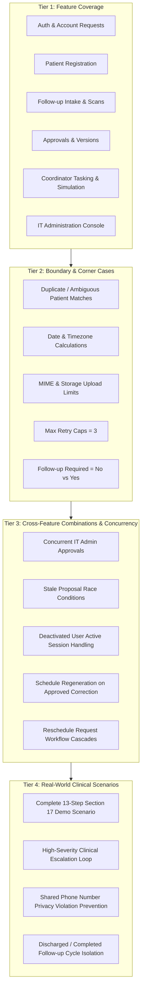

# Exhaustive QA, Testing, Security, and Compliance Specification Survey
**Target Document:** `HOSPITAL_FOLLOWUP_BUILD_SPEC.md`  
**Explorer Identity:** `teamwork_explorer` (Survey 3)  
**Date:** 2026-10-30  
**Focus Areas:** Testing Specifications, QA Mandates, 4-Tier Testing Model, Edge Cases & Validation, Security/HIPAA/GDPR Privacy, Test Harness & Verification Pipeline  

---

## 1. Executive Summary

This specification survey provides an exhaustive, authoritative breakdown of all verification mandates, testing requirements, security architectures, privacy rules, edge cases, and quality gates specified in `HOSPITAL_FOLLOWUP_BUILD_SPEC.md`.

The hospital follow-up continuity system is a security-critical, high-assurance healthcare web application built on **Next.js (App Router, TypeScript Strict)**, **Supabase PostgreSQL (RLS, Triggers, RPCs)**, **Supabase Auth**, **Supabase Storage**, **pg_cron**, and **Vercel**. Because this system manages patient follow-up continuity, records clinical decisions, and coordinates communication tasks, the specification establishes strict, non-negotiable boundaries:
1. **Zero Mock-ups / Zero Dead Controls:** Every visible button, form, filter, or chart must connect to persistent database-backed operations or be disabled with an explicit explanation (Lines 19, 32).
2. **Dual-Layer Authorization:** Authorization must be enforced both in PostgreSQL Row Level Security (RLS) policies and in server-side domain operations (`require-user.ts` / server actions). Front-end route guards are presentation-only (Lines 21, 670–680).
3. **Immutable History and Attribution:** Records, versions, approvals, communication attempts, and audit events are strictly append-only. No physical deletion of users or clinical/operational data is permitted (Lines 72, 651, 680).
4. **Human Accountability & AI Bounds:** AI form extraction is strictly advisory (draft proposals only); no autonomous clinical triage, diagnosis, severity calculation, or approval is permitted (Lines 24, 62, 744–763).
5. **Truthful Simulated Communications:** No external SMS/telephony gateways exist in this release; manual actions must be explicitly recorded and displayed as "Manually confirmed / simulated — not provider verified" (Lines 25, 74, 381, 574).
6. **Strict Handling of Open Questions (OQ-01 to OQ-16):** Undecided business rules (e.g. reminder spacing formulas, multi-department membership, cancellation policy) must NOT be silently invented; they must be implemented behind configuration interfaces and kept in an explicit `needs_configuration` / disabled state (Lines 26, 528–540, 1110–1132).

---

## 2. QA Mandates, Verification Procedures, and Definition of Done

### 2.1 The Definition of Done (DoD)
As codified in Section 0 (Lines 30–33):
> *"The app is only complete when an authorised user can sign in, land on the correct role dashboard, complete their permitted workflows, see persistent database-backed updates, and be denied every prohibited action in both the UI and the database/API. The account-request approval lifecycle, all six operational dashboards, IT administration, audit trail, RLS, responsive UI, tests, and deployment configuration must work end to end."*

### 2.2 Phase-by-Phase Exit Checks (Section 13)
The spec defines 8 phases (Phase 0 to Phase 7), each bound by an explicit, mandatory exit check (Lines 896–974):

| Phase | Title | Mandatory Exit Check Criteria |
|---|---|---|
| **Phase 0** | Repository & Deployment Skeleton | Production build succeeds (`npm run build`); app runs locally; zero secrets leaked in client bundle or git (Line 908). |
| **Phase 1** | Auth, Profiles & Account Requests | Each test account lands on designated dashboard; public users cannot self-register; IT approval required for all accounts; role/status tampering payload rejected (Line 918). |
| **Phase 2** | Shared Layout & 6 Dashboards | No dummy counts, hardcoded arrays, or dead buttons; each role accesses only its own dashboard and permitted data; real DB-derived metrics (Line 926). |
| **Phase 3** | Patient Registration & Storage | Reception can search/register; cannot view clinical notes; duplicate/ambiguous matches blocked; signed storage URLs enforce role/department access (Line 934). |
| **Phase 4** | Follow-up Intake, Versions & Approvals | Direct edits to submitted records rejected; approved proposals create new version atomically, updating schedule while preserving old version and source document (Line 944). |
| **Phase 5** | Operations, Reminders & Workload | No duplicate reminder jobs; cancelled jobs cannot run; completed cycles cancel pending jobs; manual sends labeled simulated; unconfigured formulas remain disabled (Line 954). |
| **Phase 6** | Queries, Notifications & AI Adapter | E2E query thread (Coordinator → Assistant → Doctor) works; deep links re-verify permissions; AI adapter behind disabled feature flag with human review UI (Line 963). |
| **Phase 7** | Hardening & Release Verification | Full RLS matrix tests pass; Playwright E2E for all 7 roles passes; WCAG accessibility & responsive pass; dependency/secret scans clean; backup runbooks verified (Lines 967–973). |

### 2.3 The 14 Mandatory Release Gates (Section 15.4)
Before real patient data can be processed, all 14 gates must pass (Lines 1089–1105):
1. [ ] Hospital owner sign-off on final role/department boundaries.
2. [ ] Open decisions in Section 16 resolved or related features kept visibly disabled (`needs_configuration`).
3. [ ] Privacy/legal review and hospital security approval completed.
4. [ ] Real-data environment and third-party data processing terms formally approved.
5. [ ] Multi-Factor Authentication (MFA) for IT Admin enabled; privileged account recovery runbook documented.
6. [ ] All RLS tests, negative access tests, and IDOR tests pass with 100% success.
7. [ ] External penetration test completed; all critical/high vulnerabilities remediated.
8. [ ] Vulnerability, dependency, and secret scans pass.
9. [ ] Backup and restoration successfully tested against agreed RPO/RTO.
10. [ ] Incident response, access revocation, key rotation, and breach escalation runbooks documented.
11. [ ] Storage upload, quarantine, MIME validation, and signed-link policies verified.
12. [ ] Data retention, deletion, and audit trail retention policies approved.
13. [ ] Clinical owner verifies all form fields, severity definitions, and clinical workflow language.
14. [ ] Reminder formula, contact consent, daytime window, and assignment strategy approved prior to activation.

---

## 3. The 4-Tier Testing Model Architecture

The test suite must be organized across four distinct conceptual tiers to guarantee full verification from isolated features to end-to-end clinical operations.



### 3.1 Tier 1: Feature Coverage (Core Functionality Across 7 Roles)
Covers baseline happy paths and primary business logic for every subsystem:
1. **Public & Account Request Subsystem:**
   - Public visitor loads `/` (branding, login button, request account button, privacy notice).
   - Public user fills `/request-access` form with valid fields; form saves to `account_requests` with status `pending`. No Supabase Auth user is created.
   - IT Admin reviews queue at `/it-admin`, approves request, triggers Auth invite. Mapped profile created in `invited` status.
   - User clicks secure invite link at `/invite/accept`, sets password, and profile transitions to `active`.
2. **Dashboard Landing & Authentication:**
   - 6 Operational Roles (`reception`, `assistant`, `doctor`, `department_head`, `coordinator`, `follow_up_head`) + `it_admin` log in via `/login` and redirect to their exclusive dashboard URL.
   - Top-bar user profile, active role indicator, department tag, unread notification counter, and logout work.
3. **Reception Subsystem (`/reception`):**
   - Patient search by name / ID returns matching results without exposing clinical notes or severity.
   - Patient registration creates unique immutable `patient_id` in `patients` table, records contacts in `patient_contacts`, and logs audit event.
   - Contact verification status toggling and shared contact flag marking.
   - Submission of patient demographic correction proposal.
4. **Assistant Subsystem (`/assistant`):**
   - Search/select existing patient and confirm DOB; search/select doctor and confirm department.
   - Manual intake: fill clinical form (severity Normal/Moderate/Severe, follow-up required Yes/No, appointment date, clinical notes).
   - Scan intake: upload mock PDF/PNG, store in private storage bucket `source_documents`, view draft fields, review/edit, preview, and submit.
   - Submission creates `follow_ups` row with status `SUBMITTED` (or `ACTIVE`) and immutable initial snapshot in `follow_up_versions`.
   - Recording attendance/completion outcomes (`follow_up_outcomes`).
5. **Doctor Subsystem (`/doctor`):**
   - View assigned patients/follow-ups; read clinical notes and version history.
   - Submit correction request with rationale; review clinical queries.
   - Respond to patient reschedule requests with clinical decisions.
6. **Department Head Subsystem (`/department-head`):**
   - View department-scoped queue of pending correction proposals and manual schedule changes.
   - Compare side-by-side diff (current values vs proposed values, requester, evidence, reason).
   - Approve proposal: atomically inserts new version in `follow_up_versions`, updates current `follow_ups`, logs in `approval_decisions`, and cancels/regenerates reminder jobs.
   - Reject proposal with mandatory justification: preserves existing record and schedule intact.
7. **Coordinator Subsystem (`/coordinator`):**
   - View "My Tasks" queue (due, overdue, upcoming, completed).
   - View patient contact details with prominent shared-number warning.
   - Confirm simulated text send: records `MANUALLY_CONFIRMED_SIMULATED_SEND` in `communication_attempts` with timestamp and coordinator actor ID.
   - Log call attempt outcome (Answered, No answer, Unreachable, Callback requested) and patient response (Appointment confirmed, Rescheduling requested, Declined, Clinical guidance needed).
   - In-app query creation linked to follow-up, routing to assistant.
8. **Follow-up Head Subsystem (`/follow-up-head`):**
   - View live operational metrics (active assignments, overdue count, coordinator workload distribution).
   - Manual priority assignment to specific coordinator with workload warning and override audit.
   - Authorize reassignment for deactivated/unavailable coordinator.
9. **IT Administration Console (`/it-admin`):**
   - User lifecycle: invite, map, activate, suspend, deactivate, reactivate.
   - Security audit log viewer with filtering by actor, action type, and date range.
   - System configuration status viewer (`schedule_configs`, feature flags).

---

### 3.2 Tier 2: Boundary & Corner Cases
Covers mathematical edge cases, limits, formatting extremes, and edge constraints:

| Test ID | Area | Scenario & Boundary Condition | Expected Behavior |
|---|---|---|---|
| **TC-BND-01** | Patient Search | Search query with leading/trailing whitespaces, punctuation, accents, or single character. | Sanitized server-side; does not trigger SQL injection or crash query. |
| **TC-BND-02** | Patient Deduplication | Exact name match with identical DOB vs same name with different DOB. | Never auto-selects; presents disambiguation UI requiring secondary confirmation. |
| **TC-BND-03** | Patient Registration | Missing date of birth (DOB) or future DOB. | Zod validation rejects invalid DOB; age cannot be negative. |
| **TC-BND-04** | Contact Phone | International format (`+91...`), leading zero, 10-digit, 11-digit, or alphabetical garbage. | Normalizes phone number or rejects invalid format before insert. |
| **TC-BND-05** | Shared Contact Flag | Two distinct patients register with the exact same primary phone number. | System flags `shared_contact = true` with warning notice on coordinator view. |
| **TC-BND-06** | Follow-up Required Flag | Follow-up required = `false`. | Appointment date field disabled/optional; zero reminder jobs generated. |
| **TC-BND-07** | Mandatory Date Rule | Follow-up required = `true` but appointment date omitted. | Submission blocked by both client-side Zod and database constraint. |
| **TC-BND-08** | Appointment Past Date | Appointment date set in the past relative to current hospital local time. | Rejects past dates for new follow-ups; requires future calendar date. |
| **TC-BND-09** | Hospital Timezone Anchor | Appointment set for midnight or near midnight across DST/timezone transitions (`Asia/Kolkata`). | Calculated calendar days rely on hospital timezone date math, not naive 24h millisecond addition. |
| **TC-BND-10** | Overdue Triggers | Follow-up reaches appointment date + 1 day with no recorded completion. | Status transitions to `OVERDUE`; tasks generated for +2 and +4 calendar days. |
| **TC-BND-11** | Overdue Cap (+2/+4) | Clock advances to appointment date + 5 days, +10 days, +30 days. | Exactly two overdue text tasks generated (+2 and +4 days); no further automatic tasks created. |
| **TC-BND-12** | Max Retry Limit | Communication task attempted 3 times with outcome `Unreachable` or `No answer`. | Retry counter hits 3; automatic rescheduling stops; escalated to coordinator queue. |
| **TC-BND-13** | Storage Upload MIME | File upload with extension `.pdf` but binary contents are executable (`.exe`/shell) or SVG. | Magic byte validation rejects payload; only valid PDF/JPEG/PNG accepted. |
| **TC-BND-14** | Storage File Size | Scanned document exceeds max allowed limit (e.g. 10MB or configured limit). | Server rejects upload with HTTP 413 / clear client error before storage persistence. |
| **TC-BND-15** | Input Payload Size | Requester justification or clinical notes exceed maximum character limit (e.g. 5,000 chars). | Truncated or rejected with validation error; prevents database DOS/buffer abuse. |

---

### 3.3 Tier 3: Cross-Feature Combinations & Concurrency
Covers multi-user races, asynchronous conflicts, distributed state invalidation, and transactional integrity:

```mermaid
sequenceDiagram
  autonumber
  actor DH1 as Department Head 1
  actor DH2 as Department Head 2
  participant DB as Supabase PostgreSQL
  participant SCH as Reminder Scheduler

  Note over DH1, DH2: Concurrent Approval Race
  DH1->>DB: Approve Proposal A (base_version = 1)
  DH2->>DB: Approve Proposal B (base_version = 1)
  DB->>DB: Lock record; Proposal A updates current_version to 2
  DB-->>DH1: Commit Success (Version 2 created)
  DB->>DB: Check Proposal B (base_version = 1 != current_version = 2)
  DB-->>DH2: Conflict Error: Stale Proposal (Renewed Review Required)
  DB->>SCH: Regenerate jobs for Version 2; cancel unexecuted Version 1 jobs
```

1. **Concurrent Account Approval Race:**
   - Two IT Admins view the same pending account request simultaneously and click "Approve" at the same instant.
   - **Verification:** Database transaction with conditional update (`WHERE status = 'pending'`) guarantees exactly one succeeds; the second receives an error or idempotent no-op. Exactly one Auth invite is triggered.
2. **Concurrent Clinical Proposal Approval Race:**
   - Department Head receives two competing correction proposals for the same follow-up record based on `base_version = 1`.
   - Department Head approves Proposal A, creating `version = 2`.
   - **Verification:** When Proposal B is processed, the system detects `base_version (1) != current_version (2)`. Proposal B is marked `STALE_CONFLICT`, requiring renewed review. Proposal B cannot silently overwrite Version 2.
3. **Atomic Version & Schedule Transition:**
   - Approving a date correction triggers: (a) insertion of `follow_up_versions`, (b) update of `follow_ups`, (c) cancellation of unsent `reminder_jobs` for previous version, (d) creation of new `reminder_jobs` for new date, (e) write to `audit_events`.
   - **Verification:** If job creation or audit fails, entire transaction rolls back. No orphaned versions or unsynchronized reminder schedules.
4. **Deactivated Staff with Active Assignments:**
   - IT Admin deactivates an active Coordinator who currently has 5 assigned pending communication tasks.
   - **Verification:**
     - The coordinator's active session is invalidated immediately (subsequent API calls return 401/403).
     - Follow-up Head's dashboard shows an exception alert: 5 cases requiring reassignment.
     - System does NOT silently drop or reassign cases; reassignment requires explicit Follow-up Head authorization.
     - Deactivated coordinator retains read-only access to previously handled cases for auditing, but cannot modify records.
5. **Reschedule Request vs Cron Execution Race:**
   - Patient requests a reschedule; Coordinator logs "Rescheduling requested" and escalates query.
   - While Doctor and Department Head evaluate the reschedule, the original reminder job's scheduled execution time arrives.
   - **Verification:** Reminder engine executes against the active schedule version. If the new schedule is approved, unexecuted old jobs are marked `CANCELLED`. If an old reminder was already confirmed, a correction task is queued.
6. **Cycle Completion vs Pending Jobs:**
   - Assistant records patient attendance and marks follow-up cycle as `COMPLETED`.
   - **Verification:** All remaining unsent/future `reminder_jobs` for that cycle are transitioned to `CANCELLED`. Cron job ignores cancelled jobs.

---

### 3.4 Tier 4: Real-World Clinical Scenarios
Covers complete, multi-role end-to-end hospital workflows that simulate live clinical operations:

#### Scenario A: The Section 17 Authoritative 13-Step Connected Demo
This scenario MUST pass 100% in Playwright and manual verification:
1. Visitor navigates to `/` and submits account request at `/request-access`.
2. Request appears in IT Admin queue (`/it-admin`); zero Auth users exist while pending.
3. IT Head approves request; invite dispatched; user accepts at `/invite/accept` and sets password; profile becomes `active` with approved role.
4. Each of the six operational test accounts signs in and verifies landing on its own distinct dashboard:
   - `reception@hospital.test` → `/reception`
   - `assistant@hospital.test` → `/assistant`
   - `doctor@hospital.test` → `/doctor`
   - `depthead@hospital.test` → `/department-head`
   - `coordinator@hospital.test` → `/coordinator`
   - `fuhead@hospital.test` → `/follow-up-head`
   - `itadmin@hospital.test` → `/it-admin`
5. Reception searches synthetic patient directory, completes registration, verifies contact state, and flags shared contact number.
6. Assistant selects synthetic patient and doctor, uploads synthetic paper follow-up scan, edits/verifies extracted draft fields, and submits.
7. Doctor views assigned follow-up, detects clinical error (e.g. incorrect instruction or appointment date), and files structured correction request.
8. Assistant prepares formal proposal; Department Head reviews diff against base version and approves; system increments version to 2 and logs audit record.
9. System generates reminder schedule (if configuration enabled); Coordinator views assigned task, confirms simulated text send, and records call outcome.
10. Coordinator initiates query regarding patient side-effect; Assistant forwards query to Doctor; Follow-up Head views operational workload metrics without access to clinical query text.
11. Follow-up Head assigns priority task to Coordinator with workload override confirmation and mandatory justification audit log.
12. IT Admin deactivates a user; user session is immediately denied access on reload/action; historical attribution remains intact.
13. Cross-role and cross-department unauthorized access attempts (e.g. Reception viewing clinical notes, Coordinator reading unassigned case, Doctor viewing another department's records) return 403 Forbidden in UI and 0 rows / permission denied in RLS.

#### Scenario B: High-Severity Patient with Shared Phone Privacy Protection
1. Patient registered with shared family landline (`shared_contact = true`).
2. Follow-up created with severity = `Severe`.
3. Coordinator task displays prominent warning: **"SHARED CONTACT — DO NOT DISCLOSE DIAGNOSIS, SEVERITY, OR CLINICAL DETAILS"**.
4. Coordinator places call; family member answers; coordinator uses approved non-sensitive script ("Calling from City Hospital to confirm an upcoming appointment for [Patient Name]").
5. Outcome recorded as "Answered by representative; appointment confirmed".
6. Audit log verifies no PHI leaked in communications table or logs.

#### Scenario C: Patient Reschedule and Doctor Refusal Workflow
1. Coordinator calls patient; patient requests moving follow-up by 3 weeks.
2. Coordinator logs patient response "Rescheduling requested" and raises query to Assistant.
3. Assistant routes query to Doctor: "Patient requested 3-week delay".
4. Doctor determines delay is clinically unsafe due to post-operative risk; enters clinical guidance: "Delay exceeds safe window; patient must attend within 5 days or come for urgent evaluation".
5. Assistant routes doctor instruction back to Coordinator.
6. Coordinator contacts patient with doctor guidance; patient agrees to attended within 3 days.
7. Assistant files reschedule proposal for 3 days; Department Head approves; reminder schedule recalculates.

---

## 4. Exhaustive Edge Cases, Validation Constraints, and Negative Test Matrix

### 4.1 Input Validation Rules (Zod & Database Schema)
Every input must be validated server-side before reaching domain logic or SQL:

```ts
// Canonical Domain Validation Schemas
export const AccountRequestSchema = z.object({
  fullName: z.string().trim().min(2).max(100),
  workEmail: z.string().trim().email().toLowerCase(),
  staffIdentifier: z.string().trim().max(50).optional(),
  requestedRole: z.enum([
    'reception',
    'assistant',
    'doctor',
    'department_head',
    'coordinator',
    'follow_up_head'
  ]), // Note: it_admin CANNOT be requested publicly
  departmentId: z.string().uuid().optional(),
  justification: z.string().trim().min(10).max(1000),
  termsAccepted: z.literal(true, {
    errorMap: () => ({ message: 'You must accept the institutional use policy' })
  })
});

export const PatientRegistrationSchema = z.object({
  fullName: z.string().trim().min(2).max(100),
  dateOfBirth: z.string().refine((dob) => !isNaN(Date.parse(dob)) && new Date(dob) <= new Date(), {
    message: 'Date of birth must be a valid past date'
  }),
  primaryPhone: z.string().trim().regex(/^\+?[1-9]\d{7,14}$/, 'Invalid phone number format'),
  primaryPhoneVerified: z.boolean().default(false),
  alternatePhone: z.string().trim().regex(/^\+?[1-9]\d{7,14}$/).optional().or(z.literal('')),
  isSharedContact: z.boolean().default(false),
  gender: z.enum(['male', 'female', 'other', 'undisclosed']).optional()
});

export const FollowUpIntakeSchema = z.object({
  patientId: z.string().uuid(),
  doctorId: z.string().uuid(),
  departmentId: z.string().uuid(),
  followUpRequired: z.boolean(),
  severity: z.enum(['normal', 'moderate', 'severe']),
  appointmentDate: z.string().optional().refine((val) => {
    // If followUpRequired is true, appointmentDate is mandatory
    return true;
  }),
  clinicalNotes: z.string().trim().max(5000).optional(),
  sourceDocumentId: z.string().uuid().optional()
}).refine((data) => !data.followUpRequired || (data.followUpRequired && !!data.appointmentDate), {
  message: 'Appointment date is mandatory when follow-up is required',
  path: ['appointmentDate']
});
```

### 4.2 Comprehensive Negative Test Matrix

| Category | Vector / Malicious Action | Test Mechanism | Expected Rejection Point | Response / State |
|---|---|---|---|---|
| **Auth** | Unauthenticated request to `/api/patients` | `curl -X GET /api/patients` (no cookie) | Next.js middleware & server action | HTTP 401 Unauthorized / redirect `/login` |
| **Auth** | Stale JWT with `status = 'suspended'` | Replay active JWT after status change in DB | `require-user.ts` fresh DB profile query | HTTP 403 Forbidden; session terminated |
| **Auth** | Public user attempts `supabase.auth.signUp()` | Direct client call to Auth signUp API | Supabase Auth configuration (Signups disabled) | Signup rejected; error returned |
| **Auth** | Tampered role in JWT custom claims / payload | Client passes `{ role: 'it_admin' }` in body | Server loads role strictly from `profiles` table | Role spoofing ignored; RLS uses DB role |
| **Auth** | Replay of expired or reused invite link | Submit password setup with used token | `invite/accept` route handler | HTTP 400 Invalid or expired invite |
| **Auth** | IT Admin approves own account request | Request ID matching admin's own email | IT approval server action | HTTP 400 Self-approval prohibited |
| **IDOR** | Reception fetches `/api/follow-ups/[id]` | Pass UUID of clinical follow-up | Server action role check & RLS policy | HTTP 403 Forbidden (0 rows returned) |
| **IDOR** | Doctor fetches `/api/follow-ups/[id]` of other doctor | Pass UUID of follow-up from another doctor | RLS policy: `doctor_id = current_doctor_id` | HTTP 404 / 403 (0 rows returned) |
| **IDOR** | Dept Head approves other dept's proposal | Pass proposal ID belonging to Cardiology | RLS policy: `department_id = user_dept_id` | HTTP 403 / 0 rows affected |
| **IDOR** | Coordinator accesses unassigned follow-up | Direct query by follow-up UUID | RLS: `id IN (assigned_follow_ups)` | HTTP 403 / 0 rows returned |
| **Data Integrity** | Assistant attempts direct SQL `UPDATE follow_ups` | Direct update on submitted record fields | RLS `UPDATE` policy / DB Trigger | `permission denied for table follow_ups` |
| **Data Integrity** | Doctor attempts direct SQL `UPDATE follow_ups` | Direct update on clinical notes / severity | RLS `UPDATE` policy / DB Trigger | Direct update blocked; proposal required |
| **Data Integrity** | Double-click submission of follow-up intake | Rapid parallel POST requests | DB Unique constraint on idempotency key | First succeeds, second returns existing ID |
| **Data Integrity** | Delete audit event or patient record | Direct `DELETE FROM audit_events` | RLS revoke `DELETE` on operational tables | `permission denied for table audit_events` |
| **Storage** | Upload executable `.sh` renamed as `.pdf` | Magic byte inspection in upload action | File scanner / MIME inspection | HTTP 415 Unsupported Media Type |
| **Storage** | Access raw storage object URL directly | Open `https://.../storage/v1/object/public/...` | Supabase Storage private bucket policy | HTTP 400 / 403 Access Denied |
| **Storage** | Stale signed URL reuse after expiration | Request signed URL older than 60 seconds | Storage token expiration validator | HTTP 403 Expired Token |
| **Scheduler** | Re-run cancelled reminder job | Invoke worker on job with `status = 'cancelled'` | Job processor check `status = 'pending'` | Job skipped; zero communication created |
| **Scheduler** | Fourth retry on failed reminder task | Trigger retry after `retry_count = 3` | Worker enforces `retry_count < 3` | Escalated to exception state; no retry |
| **AI Bounds** | AI adapter attempts to approve proposal | Call approval RPC with AI service identity | Approval RPC enforces human role check | Rejected; human approver required |

---

## 5. Security, Privacy (HIPAA/GDPR), Audit Trail & Regulatory Architecture

### 5.1 Principle of Least Privilege & Default-Deny RLS Matrix
PostgreSQL Row Level Security (RLS) is the bedrock security boundary. Broad `FOR ALL` policies are strictly prohibited (Line 673). Every table must have explicit, separate `SELECT`, `INSERT`, `UPDATE`, and `DELETE` policies.

Below is the definitive RLS Policy Matrix across all primary tables:

| Table Name | `anon` | `reception` | `assistant` | `doctor` | `department_head` | `coordinator` | `follow_up_head` | `it_admin` |
|---|---|---|---|---|---|---|---|---|
| `profiles` | None | Self read | Self + Dept read | Self + Dept read | Dept staff read | Self read | Pool read | Full Read/Update |
| `account_requests` | Insert only | None | None | None | None | None | None | Full Read/Update |
| `patients` | None | Search RPC / Create | Linked read | Authorised read | Dept read | Assigned read-only | Aggregate read | No clinical/patient |
| `patient_contacts` | None | Create / Update | Linked read | Authorised read | Dept read | Assigned read (min) | Aggregate read | No access |
| `follow_ups` | None | None | Create/Draft/Read | Own doctor read | Own dept read | Assigned case read | Aggregate metrics | No clinical data |
| `follow_up_versions` | None | None | Read linked | Read own | Read dept | None / minimal | None | No access |
| `source_documents` | None | None | Upload / Read linked | Read own | Read dept | None | None | No access |
| `correction_requests` | None | Submit demographic | Create proposal | Request correction | Approve/Reject dept | Query link only | None | None |
| `reminder_jobs` | None | None | None | None | None | None | None (Cron only) | Operational monitor |
| `communication_tasks`| None | None | Linked read | None | None | Read/Update assigned| Workload manage | None |
| `communication_attempts`| None | None | Linked read | None | None | Insert own attempt | Read-only metrics | None |
| `internal_queries` | None | None | Participate linked | Participate linked | Dept read | Participate assigned| Escalate only | None |
| `notifications` | None | Own read/update | Own read/update | Own read/update | Own read/update | Own read/update | Own read/update | Own read/update |
| `audit_events` | None | None (triggers) | None (triggers) | None (triggers) | Dept audit read | None (triggers) | Operations audit | Security audit read |

#### Critical PostgreSQL RLS Security Helper Function Specifications:
```sql
-- Helper: Verify user is active and has specific role
CREATE OR REPLACE FUNCTION auth.is_active_role(required_role text)
RETURNS boolean
LANGUAGE sql
SECURITY DEFINER
SET search_path = public, auth
STABLE
AS $$
  SELECT EXISTS (
    SELECT 1 FROM public.profiles
    WHERE id = auth.uid()
      AND role = required_role
      AND status = 'active'
  );
$$;

-- Helper: Check department match
CREATE OR REPLACE FUNCTION auth.is_department_member(dept_id uuid)
RETURNS boolean
LANGUAGE sql
SECURITY DEFINER
SET search_path = public, auth
STABLE
AS $$
  SELECT EXISTS (
    SELECT 1 FROM public.department_memberships
    WHERE user_id = auth.uid()
      AND department_id = dept_id
  );
$$;

-- Helper: Check coordinator assigned case
CREATE OR REPLACE FUNCTION auth.is_assigned_coordinator(target_follow_up_id uuid)
RETURNS boolean
LANGUAGE sql
SECURITY DEFINER
SET search_path = public, auth
STABLE
AS $$
  SELECT EXISTS (
    SELECT 1 FROM public.communication_tasks
    WHERE follow_up_id = target_follow_up_id
      AND assigned_coordinator_id = auth.uid()
      AND status IN ('pending', 'in_progress', 'due')
  );
$$;
```

### 5.2 Privacy Protections & Confidential Health Data (HIPAA / GDPR Equivalent)
1. **Zero Real Patient Data (Synthetic Mandate):** Real patient names, numbers, or records must never enter the repository, test fixtures, or demo environments (Line 23). All demo and seed data must be explicitly flagged with `synthetic: true` or clear fake indicators (`John Synthetic Doe`).
2. **Minimal Disclosure & Field Separation:**
   - Reception receives only demographic/contact fields. Clinical notes, diagnoses, severity, and prescriptions are excluded from Reception queries (Lines 321, 442).
   - Coordinators see the minimal contact details required to initiate communication. They do not have access to full clinical charts or past unrelated consultations (Line 385).
   - Follow-up Head sees operational aggregate metrics (e.g. workload counts, overdue counts), never unrestricted clinical note bodies (Lines 400, 691).
   - IT Admin has zero clinical data access; IT console is strictly for account provisioning, security logs, and role management (Lines 413, 692).
3. **Shared Contact Privacy Firewall:**
   - When `isSharedContact = true`, the UI and communication templates must suppress all clinical specifics (severity, diagnosis, treatment, doctor notes) (Line 445).
   - Approved non-sensitive communication wording: *"This is a reminder regarding an upcoming hospital appointment for [Patient Full Name]. Please contact City Hospital at [Hospital Contact] to confirm."*
4. **Data Minimization in Logs:**
   - Application logs and audit tables must redact passwords, auth tokens, credit details, phone numbers, and full clinical note bodies (Lines 703, 732). Only metadata, hashes, record IDs, and redacted snippets are recorded.
5. **Private Storage & Short-Lived Signed URLs:**
   - Scanned medical forms in Supabase Storage must be stored in private, unlisted buckets.
   - Access to files is strictly brokered through server actions that verify user authorization, generating signed URLs with a TTL of ≤ 60 seconds (Line 725).

### 5.3 Immutable Audit Engine Architecture
The audit system is append-only and enforced at the database level:
- Application roles are explicitly denied `UPDATE` and `DELETE` on `audit_events`.
- Triggers automatically log structural changes (e.g. status changes, version increments).
- Domain RPCs capture business context (actor, role, action, target_type, target_id, before_snapshot, after_snapshot, justification_reason, client_ip, request_id, timestamp).
- Audited actions:
  - Account lifecycle (request, approval, invite, password reset, suspension, deactivation).
  - Patient lifecycle (registration, demographic correction proposal, approval).
  - Follow-up lifecycle (draft creation, form upload, intake submission, version increment).
  - Clinical corrections (proposal submission, department head approval, rejection with reason).
  - Communication attempts (simulated text send, call attempt, patient outcome).
  - Coordinator operations (priority task assignment, override justification, reassignment).
  - IT Admin interventions (role change, department remapping).

### 5.4 Defensive Handling of Open Questions (OQ-01 through OQ-16)
To satisfy Section 0 Rule 10 and Section 16 without silently inventing clinical rules:

| Open Decision ID | Topic | Required Defensive Implementation | Test Assertion |
|---|---|---|---|
| **OQ-01** | Multi-department membership | Schema supports `department_memberships` table, but enforcement logic defaults to single department. | Test asserts user limited to 1 active department; rejects multi-department assignments unless flag enabled. |
| **OQ-02** | Correction routing if Assistant inactive | If original Assistant is deactivated, route correction directly to Department Head. | Test verifies route fallback to Department Head queue when assistant status is `deactivated`. |
| **OQ-03** | Dept Head for Reception demographic corrections | Queue demographic corrections in a shared unassigned queue or route to hospital administration. | Test verifies demographic correction is visible to designated reviewing authority without throwing null error. |
| **OQ-04 / OQ-05 / OQ-06** | Reminder spacing, ratios & daytime window | Mark `schedule_configs` as `needs_configuration = true`. Engine remains disabled by default. | Test asserts engine generates zero automatic pre-appointment jobs until admin approves config. |
| **OQ-07** | Follow-up cancellation & reopen rules | Cancellation and reopen controls remain hidden from operational dashboards. | Test asserts no unauthorized user can trigger cancellation endpoint; returns HTTP 403 / unexposed. |
| **OQ-08** | Coordinator workload weight formula | Implement load-based assignment interface with unweighted queue fallback. | Unassigned cases fall into visible exception queue; test confirms unassigned tasks never disappear. |
| **OQ-09** | Max retries and delays | Enforce hard cap of 3 attempts. Exact delays configured in schedule settings. | Test confirms 4th attempt is strictly blocked and triggers supervisor escalation. |
| **OQ-10** | Contact consent & preferences | Separate verification from consent in `patient_contacts`. Require explicit consent flag. | Test confirms communication task checks consent status before scheduling. |
| **OQ-14** | Paper form layout & OCR fields | Define strict schema for mandatory fields (Patient, DOB, Doctor, Date, Severity, Notes). | Test validates OCR adapter returns typed fields matching schema or flags review. |

---

## 6. Test Harness, Test Runners, Mocking Strategies, and Verification Pipeline

### 6.1 Tooling & Framework Selection
In accordance with Section 2.1 (Line 95) and Section 15.1:
- **Unit & Integration Testing:** `Vitest` (`vitest.config.ts`) with `@testing-library/react`.
- **Database & RLS Testing:** Supabase CLI / `pgTAP` (`supabase/tests/rls/*.sql`, `supabase/tests/database/*.sql`) executed via `supabase test db`.
- **End-to-End (E2E) Browser Testing:** `Playwright` (`playwright.config.ts`, `tests/e2e/*.spec.ts`).
- **Static Analysis & Linting:** `eslint`, `typescript` (`tsc --noEmit`), `prettier`.

### 6.2 Test Suite Layout

```text
dd/
├── src/
│   ├── features/
│   │   ├── auth/__tests__/
│   │   │   ├── require-user.test.ts
│   │   │   └── permissions.test.ts
│   │   ├── access-requests/__tests__/
│   │   │   ├── access-request.service.test.ts
│   │   │   └── access-request.schema.test.ts
│   │   ├── patients/__tests__/
│   │   │   ├── patient.service.test.ts
│   │   │   └── deduplication.test.ts
│   │   ├── follow-ups/__tests__/
│   │   │   ├── follow-up.service.test.ts
│   │   │   └── state-machine.test.ts
│   │   ├── corrections/__tests__/
│   │   │   ├── correction.service.test.ts
│   │   │   └── concurrency-lock.test.ts
│   │   ├── schedules/__tests__/
│   │   │   ├── reminder-strategy.test.ts
│   │   │   └── overdue-calculator.test.ts
│   │   └── communication/__tests__/
│   │       ├── communication-task.service.test.ts
│   │       └── retry-limiter.test.ts
├── supabase/
│   ├── tests/
│   │   ├── rls/
│   │   │   ├── 01_profiles_rls.test.sql
│   │   │   ├── 02_patients_rls.test.sql
│   │   │   ├── 03_follow_ups_rls.test.sql
│   │   │   ├── 04_corrections_rls.test.sql
│   │   │   ├── 05_communication_rls.test.sql
│   │   │   ├── 06_storage_rls.test.sql
│   │   │   └── 07_audit_events_rls.test.sql
│   │   ├── database/
│   │   │   ├── 01_immutable_version_trigger.test.sql
│   │   │   ├── 02_concurrency_race.test.sql
│   │   │   └── 03_audit_trigger.test.sql
│   │   └── fixtures/
│   │       └── test_seed.sql
└── tests/
    └── e2e/
        ├── 01_auth_lifecycle.spec.ts
        ├── 02_reception_intake.spec.ts
        ├── 03_assistant_submission.spec.ts
        ├── 04_clinical_approvals.spec.ts
        ├── 05_coordinator_simulation.spec.ts
        ├── 06_followup_head_workload.spec.ts
        ├── 07_it_admin_governance.spec.ts
        ├── 08_idor_security_matrix.spec.ts
        └── 09_full_clinical_demo_scenario.spec.ts
```

### 6.3 Mocking Strategies & Test Doubles
1. **Supabase Client Test Doubles for Unit Testing:**
   - In unit tests where the live database is not invoked, provide a typed mock wrapper for `@supabase/ssr` that simulates query builders (`.from().select().eq().single()`) and error codes (e.g. `PGRST116`).
   - For domain service testing, use dependency injection to supply mock repositories.
2. **AI Form Extraction Provider Double (`FormExtractionProvider`):**
   - In accordance with Section 9.3:
   ```ts
   export class MockFormExtractionProvider implements FormExtractionProvider {
     async extract(input: { documentReference: string }) {
       return {
         fields: {
           patientName: 'Jane Synthetic Doe',
           dob: '1985-05-15',
           doctorName: 'Dr. John Synthetic Surgeon',
           followUpRequired: true,
           severity: 'moderate',
           appointmentDate: '2026-11-20',
           notes: 'Post-operative wound inspection at 2 weeks.'
         },
         confidence: {
           patientName: 0.98,
           appointmentDate: 0.95,
           severity: 0.90,
           notes: 0.85
         },
         warnings: [],
         modelId: 'mock-ocr-v1',
         modelVersion: '1.0.0-test'
       };
     }
   }
   ```
3. **Email / Notification Service Double:**
   - Mock SMTP mailer that captures sent invitations into an in-memory queue for assertion in E2E tests without transmitting actual outbound network packets.
4. **Synthetic Clock & Timezone Testing:**
   - Use `vi.useFakeTimers()` in Vitest to test time-sensitive transitions (+2 days, +4 days overdue, daytime communication windows, invite expiration).

### 6.4 Verification Scripts & Pre-Commit Pipeline
To guarantee 100% test pass rate across the full stack, the project configuration must include the following npm scripts:

```json
{
  "scripts": {
    "lint": "next lint",
    "type-check": "tsc --noEmit",
    "test:unit": "vitest run",
    "test:db": "supabase test db",
    "test:e2e": "playwright test",
    "test:all": "npm run lint && npm run type-check && npm run test:unit && npm run test:db && npm run test:e2e",
    "build": "next build"
  }
}
```

---

## 7. Actionable Implementation Checklist for Coding Agents

### Step 1: Database & RLS Security Hardening
- [ ] Write SQL migrations defining all 27 tables with UUID PKs, FK constraints, and check constraints.
- [ ] Enable RLS on all 27 tables; write discrete `SELECT`, `INSERT`, `UPDATE`, `DELETE` policies for all 7 roles + `anon`.
- [ ] Implement `auth.is_active_role()`, `auth.is_department_member()`, `auth.is_assigned_coordinator()` security helper functions with `SECURITY DEFINER` and `SET search_path = public, auth`.
- [ ] Implement database triggers to enforce immutable history on `follow_up_versions`, `approval_decisions`, and `audit_events`.
- [ ] Run `supabase test db` to verify all positive and negative RLS assertions pass.

### Step 2: Server-Side Authentication & Access Request Lifecycle
- [ ] Configure Supabase Auth with public signups disabled.
- [ ] Create `/request-access` public form validating via Zod; saves to `account_requests`.
- [ ] Create `/it-admin` account approval interface using server-only Supabase Admin client to dispatch Auth invite.
- [ ] Build `/invite/accept` password creation flow transitioning profile from `invited` to `active`.
- [ ] Implement `require-user.ts` verifying user identity and active status on every server request.

### Step 3: Operational Dashboards & Workflows
- [ ] Build `/reception`: patient search (minimal disclosure), deduplication check, registration, and demographic correction proposal.
- [ ] Build `/assistant`: manual form intake, private storage document upload, draft review, submission, and completion logging.
- [ ] Build `/doctor`: assigned patient list, version history viewer, correction request filing, query replies.
- [ ] Build `/department-head`: diff-based approval queue, atomic version + schedule approval, rejection with reason.
- [ ] Build `/coordinator`: "My Tasks" queue, shared phone number warning, manual simulated send confirmation, call outcome logging.
- [ ] Build `/follow-up-head`: aggregate metrics, coordinator workload management, priority assignment with override audit.

### Step 4: Reminder Scheduler & Simulated Communications
- [ ] Implement `ReminderScheduleStrategy` interface with `schedule_configs` marked `needs_configuration`.
- [ ] Implement overdue calendar-day logic (+2 days and +4 days in hospital timezone `Asia/Kolkata`).
- [ ] Configure `reminder_jobs` schema with idempotency keys and row-level locking (`FOR UPDATE SKIP LOCKED`).
- [ ] Implement 3-retry attempt cap with escalation logic.

### Step 5: Verification & Go-Live Readiness
- [ ] Execute `npm run lint` and `npm run type-check` (zero errors).
- [ ] Execute `npm run test:unit` covering schemas, state machines, and calculations.
- [ ] Execute `npm run test:db` verifying table-by-table RLS matrix.
- [ ] Execute `npm run test:e2e` verifying the Section 17 13-step scenario in Playwright.
- [ ] Execute `npm run build` verifying production bundle generation without secret leakage.
