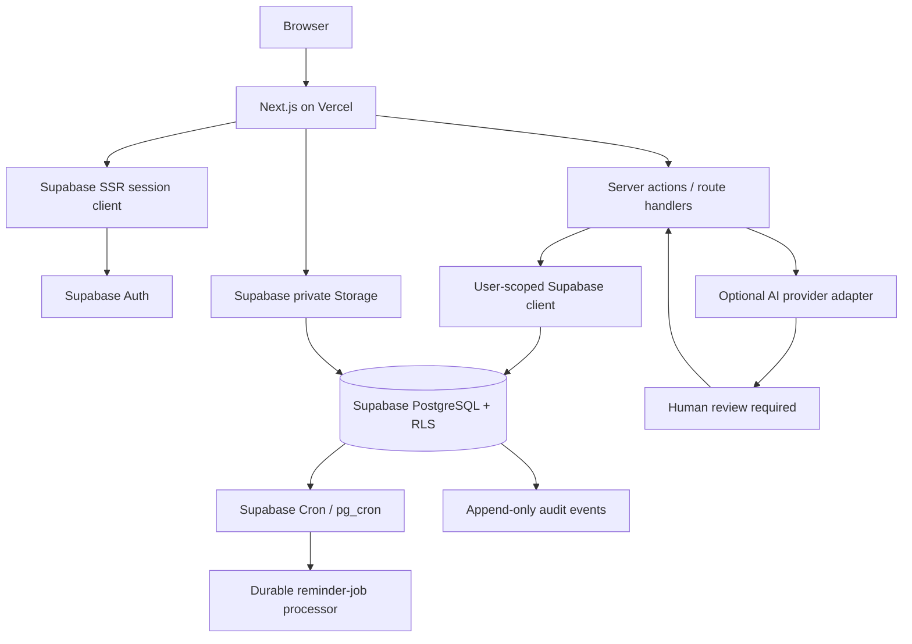

# Hospital Follow-up Continuity System — Production Build Specification

> **Purpose:** Give this file to the coding agent responsible for implementing the complete application. Build a working, secure, production-oriented website—not a clickable mock-up.
>
> **Stack fixed by the product owner:** Next.js + TypeScript, Supabase PostgreSQL, Supabase Auth, Supabase Storage, and Vercel hosting.
>
> **Product status:** Working product specification. Open clinical and operational decisions are explicitly marked `OPEN`; do not silently invent answers.
>
> **Core roles:** Reception, Doctor's Assistant, Doctor, Department Head, Follow-up Coordinator, Follow-up Head. IT Head / IT Admin is a separate privileged account-management console, not one of the six operational dashboards.

---

## 0. Instructions to the coding agent

Build the complete application in the repository. Do not stop at a scaffold, static dashboard, sample form, or mocked API.

1. Inspect the existing repository first. Preserve useful code and configuration. If the repository is empty, create the project using the architecture below.
2. Implement in vertical slices: database migration → RLS → server-side service/action → UI → automated tests. Do not build front-end screens against fake arrays and promise to connect them later.
3. Every visible control must perform a real, authorised action or be clearly disabled with an explanation. No dead buttons, fake success toasts, fake charts, hard-coded counts, or placeholder links.
4. Use Supabase Auth for all credentials. Never create a second password system or store passwords in application tables.
5. Enforce authorisation in PostgreSQL RLS and again in server-side domain operations. Front-end route guards are not a security boundary.
6. Use migrations for every schema, policy, function, trigger, and seed change. Never rely on undocumented manual SQL edits in production.
7. Use synthetic patient data only. Demo data must be visibly labelled synthetic. Do not migrate real patient information into the demonstration environment.
8. No clinical instruction, severity, diagnosis, treatment, or follow-up decision may be invented or autonomously approved by AI.
9. Do not implement real SMS, WhatsApp, or telephone sending in this release. The communication workflow records manual/simulated actions truthfully.
10. Do not silently resolve any `OPEN` item. Expose it as configuration or an explicit blocked/needs-configuration state and document the decision required.
11. Do not commit secrets, tokens, service keys, passwords, private patient files, or real demo credentials.
12. Before declaring completion, run lint, type-check, unit tests, database/RLS tests, production build, and end-to-end tests. Fix failures; report anything that genuinely cannot be completed.

### Definition of done

The app is only complete when an authorised user can sign in, land on the correct role dashboard, complete their permitted workflows, see persistent database-backed updates, and be denied every prohibited action in both the UI and the database/API. The account-request approval lifecycle, all six operational dashboards, IT administration, audit trail, RLS, responsive UI, tests, and deployment configuration must work end to end.

---

## 1. Product purpose and boundaries

Create a hospital patient-registration and follow-up continuity system. It digitises doctor-completed follow-up forms, maintains a trustworthy patient/follow-up history, creates appointment-anchored reminder tasks, coordinates follow-up work through a hospital-wide coordinator pool, and makes each action attributable and reviewable.

This is **not a full EHR**. It does not replace the hospital's clinical record system, prescription, doctor judgement, or established clinical governance. Doctors retain clinical authority. Department Heads approve changes to submitted records and schedules. Coordinators and administrators cannot make clinical decisions.

### 1.1 Included

- Central public landing page, login, and request-new-account workflow.
- Six role-specific operational dashboards plus a separate IT Head administration console.
- Supabase Auth accounts, session management, access approval, activation, suspension, deactivation, and reactivation.
- Patient search and registration, patient IDs, contact verification, shared-contact warning, and demographic correction requests.
- Follow-up record entry by manual input or a scanned doctor form; review/edit of extracted values; preservation of the original scan.
- Doctor lookup, follow-up submission, immutable versions, correction requests, approval/rejection, and conflict detection.
- Appointment-based reminder schedules and durable reminder jobs, behind configurable scheduling rules.
- Simulated reminder/call tasks, manual send confirmation, call outcomes, patient responses, and overdue management.
- Central coordinator pool, assignments, workload metrics, priority work, and controlled reassignment.
- In-app query threads, assistant-to-doctor escalation, notifications, and audit history.
- Optional AI-assisted form extraction and operational assistance through a provider adapter, with mandatory human review.
- Production deployment configuration, automated tests, logging, security controls, and operational documentation.

### 1.2 Excluded for this release

- Actual SMS, WhatsApp, email-to-patient, or telephony campaigns.
- Raw call recordings or storage of raw private message conversations.
- Direct integration with an existing hospital EHR/registration system.
- AI diagnosis, treatment recommendations, autonomous triage, autonomous clinical severity classification, or autonomous approval.
- Silent editing of submitted clinical records.
- Automatic online model training from patient data or user activity.

### 1.3 Non-negotiable product principles

- **Human accountability:** AI may assist; a named human remains responsible for every operational or clinical decision requiring human judgement.
- **Least privilege:** reporting hierarchy does not grant blanket access to subordinates' records.
- **Server-side enforcement:** client-side hiding is presentation only.
- **Submitted-record integrity:** changes to submitted records are proposals that require the correct approval.
- **Immutable attribution:** deactivating a user never deletes their historic identity or action attribution.
- **Versioned history:** approvals create new versions; old values and decisions remain traceable.
- **Truthful communications:** manual confirmation is not provider-verified delivery.
- **Secure by default:** deny by default, private storage, minimal collection, audit critical actions, and test both allowed and denied access.

---

## 2. Technology architecture

### 2.1 Required stack

| Layer | Technology | Use |
|---|---|---|
| Web framework | Next.js App Router | Public pages, authenticated workspaces, route handlers and server actions |
| Language | TypeScript, strict mode | Shared types, domain contracts and server/client safety |
| UI | Tailwind CSS + shadcn/ui + Lucide | Professional responsive application interface |
| Validation | Zod + React Hook Form | Shared schema validation and accessible forms |
| Identity | Supabase Auth | Email/password, invite acceptance, password reset, sessions and MFA configuration |
| Database | Supabase PostgreSQL | Relational source of truth, constraints, RLS, RPCs, triggers and audit history |
| Database client | Supabase JS + `@supabase/ssr` | Browser-safe public client and cookie-based server session handling |
| Files | Supabase Storage | Private scanned forms and supporting evidence |
| Scheduled work | Supabase Cron (`pg_cron`) + database functions | Durable due-job processing and overdue transitions |
| Hosting | Vercel | Next.js production and preview deployments |
| Tests | Vitest, Playwright, Supabase CLI / pgTAP | Unit, browser and database/RLS tests |

Use a **modular monolith**. Do not introduce microservices, a separate FastAPI backend, Redis, or an external queue unless a measured requirement justifies it. The database and Supabase services are the system of record.

### 2.2 Architecture flow



### 2.3 Supabase database connection rule

The deployed Next.js application should normally use the Supabase project URL and **publishable key** through the Supabase client libraries and Data API. It does not need a raw PostgreSQL connection string for ordinary application reads/writes. This is the preferred path because Supabase Auth and RLS remain in the request flow.

Use a PostgreSQL connection string only for database tooling/migrations or a justified direct database workload. Obtain it from **Supabase Dashboard → Connect**. Do not construct the hostname from the displayed region: pooler hostnames include a cluster index and may differ within a region. Use the direct connection for compatible IPv6/persistent connections; use the Supabase pooler mode appropriate to the runtime if a serverless SQL connection is genuinely needed. Never put a database password in `NEXT_PUBLIC_*` variables.

### 2.4 Supabase client setup

Implement separate utilities:

- `src/lib/supabase/client.ts` — browser client using `createBrowserClient` from `@supabase/ssr`.
- `src/lib/supabase/server.ts` — request-scoped server client using `createServerClient` and Next.js cookies.
- `src/lib/supabase/admin.ts` — server-only administrative client, imported only by IT/admin server operations; include `import 'server-only'`.
- `src/lib/auth/require-user.ts` — verifies the current identity server-side, loads `profiles`, rejects inactive/invited accounts, and returns a typed authorised actor.
- `src/lib/auth/permissions.ts` — typed permission helpers for UX and domain services. These helpers supplement, never replace, RLS.

Use the current official Supabase SSR pattern for the installed Next.js version. Refresh cookies in the framework's proxy/middleware layer as required by that version. For protected actions, verify the authenticated user on the server (do not trust a client-provided user ID, role, department, or cached browser state).

### 2.5 Suggested repository structure

```text
src/
  app/
    (public)/page.tsx
    (auth)/login/page.tsx
    (auth)/request-access/page.tsx
    (auth)/invite/accept/page.tsx
    (auth)/forgot-password/page.tsx
    (workspace)/layout.tsx
    (workspace)/reception/page.tsx
    (workspace)/assistant/page.tsx
    (workspace)/doctor/page.tsx
    (workspace)/department-head/page.tsx
    (workspace)/coordinator/page.tsx
    (workspace)/follow-up-head/page.tsx
    (workspace)/it-admin/page.tsx
    api/...
  components/
    app-shell/
    dashboard/
    forms/
    tables/
    approvals/
    notifications/
    ui/
  features/
    auth/
    access-requests/
    patients/
    follow-ups/
    documents/
    corrections/
    schedules/
    communication/
    assignments/
    queries/
    notifications/
    audit/
    administration/
    ai-assistance/
  lib/
    supabase/
    auth/
    validation/
    security/
    dates/
    errors/
  types/
supabase/
  migrations/
  seed.sql
  tests/
    rls/
    database/
    fixtures/
  config.toml
```

Keep business logic in `features/*/services` or domain modules, not in page components. Keep route handlers thin: parse → authenticate → authorise → call domain service → return safe result.

---

## 3. Public landing page, login and account-request approval

### 3.1 Central landing page (`/`)

Create a clean institutional landing page with:

- Hospital/system identity and concise product description.
- Primary **Login** action.
- Secondary **Request a new account** action.
- Short privacy/security notice; do not display patient data or internal metrics publicly.
- Responsive layout, professional typography, keyboard accessibility, and clear loading/error states.

### 3.2 Login (`/login`)

- Email + password login through Supabase Auth.
- Password visibility toggle, forgot-password flow, loading state, generic failure message, and rate-limit handling.
- Never reveal whether a particular email exists through public error messages.
- After successful authentication, server-load the profile and role; route the user to the correct dashboard.
- Reject `invited`, `pending`, `suspended`, and `deactivated` profiles even if an Auth session exists.
- A role mismatch, missing profile, or invalid department membership must fail closed and alert IT rather than showing a generic dashboard.
- Enforce MFA for IT Admin; configure staff MFA as a production security policy and prefer requiring it for all roles where operationally feasible.

### 3.3 Request a new account (`/request-access`)

This is a **request**, not public registration. Public users must never choose or self-assign their final role. Disable public self-service sign-ups in Supabase Auth. The public website must not call `supabase.auth.signUp`; only the approved IT Admin invite workflow may create Auth users.

Fields (minimum necessary):

- Full name
- Hospital/work email
- Employee/staff identifier (if the hospital uses one)
- Requested operational role (only the six operational roles; no IT Admin option)
- Department (only when applicable)
- Reason / brief role justification
- Acceptance of the hospital's account-use/privacy notice

Do not collect patient information, passwords, Aadhaar, or unrelated sensitive details.

Submission behaviour:

1. Validate input server-side using Zod; normalise email; reject malformed values and oversized text.
2. Apply CAPTCHA/bot protection and IP/email rate limiting. Prevent repeated pending requests for the same normalised email.
3. Persist the request in `account_requests` as `pending` with a generated request ID and timestamps. Do not create an Auth user yet.
4. Add a durable in-app notification to the IT Head queue. Send an email notification only if an email provider is configured; email is a convenience, not the source of truth.
5. Show a generic confirmation and a private request reference. Do not expose admin notes or other requesters' data.
6. Provide an anti-enumeration-safe status mechanism, preferably a secure email link/token whose hash is stored in the database. Do not make request status enumerable by email address alone.

### 3.4 IT approval lifecycle

IT Admin console must contain an account-request queue with pending, approved, rejected, expired, and cancelled filters.

Approval process:

1. IT Head opens a request and reviews identity, requested role, department and justification.
2. IT Head may approve, reject, or request clarification. Store a reason and immutable decision history.
3. IT Head confirms/sets the final role and organisational assignment. Public requester cannot request or grant `it_admin`.
4. Only after approval, use the server-only Supabase Auth Admin API to invite/create the Auth user. Prefer an email invite/password setup link; never generate, display, email, or store a shared plaintext temporary password.
5. Create/map the `profiles` row to the Supabase Auth UUID with status `invited`. The user must accept the invitation and set their password before becoming `active`.
6. On secure invite acceptance, verify the invite token server-side, require password setup, and activate the mapped profile only for that same authenticated user.
7. Record approval actor, final role, department, invite creation, invite acceptance, activation and all failures.

Important edge cases:

- If the email already belongs to a Supabase Auth account, do not create a duplicate. IT must explicitly resolve whether this is an existing authorised user, an existing disabled user, or an account conflict.
- If Auth invite creation succeeds but profile creation fails, retry idempotently and reconcile; never create a second Auth user.
- If profile creation succeeds but invite delivery fails, allow a safe resend/expiry/revoke workflow.
- Rejected requests do not create Auth users.
- IT Admin cannot approve their own request or silently grant themselves a higher role.
- Concurrent approvals are protected by a transaction/conditional update so only one decision wins.
- Deactivated users retain their ID, audit history and record attribution. Never delete/recreate them to restore access.
- Role changes and department changes are explicit audited admin actions.

### 3.5 Existing demonstration accounts

The product owner indicates that demonstration accounts have already been added securely in Supabase. **Inspect and reuse those existing Auth users; do not create duplicates or add hard-coded passwords.** Map their existing Auth UUIDs to `profiles` records and verify the intended role mapping.

Provision at minimum:

- One Reception account
- One Doctor's Assistant account
- One Doctor account
- One Department Head account
- One Follow-up Coordinator account
- One Follow-up Head account
- One IT Admin / IT Head account

That is six operational demonstration accounts plus the separate IT Admin account. If any are missing, create them through Supabase Dashboard/Auth Admin invitation or a secure, local-only provisioning script. Never seed passwords or service keys in Git. Use synthetic users and synthetic patient/follow-up records only.

Create an idempotent setup script that maps known Auth UUIDs to roles without changing existing passwords. The script must fail safely when an Auth ID/email is ambiguous. Do not expose account emails/passwords in the public landing page or repository.

---

## 4. Roles, dashboards and permission boundaries

### 4.1 Roles

Use a controlled enum or lookup table with these exact role keys:

```text
reception
assistant
doctor
department_head
coordinator
follow_up_head
it_admin
```

The IT Admin role has a separate privileged console. It is not a seventh operational dashboard. Do not allow one user to change their own role or status.

### 4.2 Dashboard 1 — Reception (`/reception`)

Purpose: patient registration and demographic/contact quality.

Features:

- Patient search before registration (name, patient ID, and approved matching fields).
- Registration form: name, DOB, primary contacts, alternate contact if supplied, contact verification status, shared-contact flag, registration actor/time.
- Generated immutable patient ID.
- Duplicate-match review requiring extra verification; never select a patient automatically when multiple matches exist.
- Patient summary limited to registration-relevant data; no clinical notes, severity, diagnosis, or prescription access.
- Submit patient demographic correction request with reason/evidence; cannot directly mutate registered profile fields.
- Search results disclose the minimum needed to distinguish a patient. Prefer a narrow server-side search RPC rather than broad access to the full patient table.

### 4.3 Dashboard 2 — Doctor's Assistant (`/assistant`)

Purpose: digitise forms and manage follow-up record workflow.

Features:

- Search/select patient; show DOB for identity confirmation.
- Search/select doctor; confirm the actual doctor identity and department association.
- Create draft from manual entry or scanned form.
- Upload original scanned form to private storage. Preserve the exact original bytes; never overwrite it with edited/extracted text.
- Optional OCR/AI extraction into editable draft fields; clearly mark confidence and unknown/uncertain fields. Assistant reviews every extracted field before submission.
- Form fields at minimum: patient ID, DOB verification, doctor ID, follow-up required, severity (Normal/Moderate/Severe), appointment date when required, instructions/notes, source document metadata.
- Preview all values and submit. Submission stores actor, timestamp, record version and original-file reference.
- If follow-up required = No, create no schedule or reminder jobs.
- If follow-up required = Yes, appointment date is mandatory and must be a valid date under the configured hospital timezone.
- View drafts, submitted records they are authorised to handle, correction proposals, patient outcomes, queries and notifications.
- Record attendance/completion and whether another follow-up is required. A new follow-up creates a new cycle; never overwrite a previous cycle.
- Prepare correction and schedule-change proposals. Cannot directly edit submitted values.

### 4.4 Dashboard 3 — Doctor (`/doctor`)

Purpose: clinical oversight and decisions.

Features:

- View only patients/follow-ups assigned to that doctor or otherwise explicitly authorised within the department rules.
- Read submitted follow-up records and version history.
- Submit a correction request with reason and proposed details; doctor cannot directly edit submitted records.
- Provide clinical decisions/instructions through the linked query workflow.
- Decide whether a patient-requested reschedule/refusal changes the clinical plan.
- Any change to submitted data or reminder schedule enters the proposal/Department Head approval workflow. A doctor's clinical opinion alone does not mutate a record or activate a new schedule.
- No unrestricted patient search across unrelated departments.

### 4.5 Dashboard 4 — Department Head (`/department-head`)

Purpose: department-scoped approval and oversight.

Features:

- Department-scoped overview and approval queue.
- Compare old values vs proposed values, request reason, evidence, requester, base record version and any stale/conflict warning.
- Approve/reject correction requests and manual schedule-change requests, with mandatory reason for rejection.
- Approval applies the new version and related schedule changes transactionally.
- Rejection leaves current values and active jobs unchanged; notify requester.
- Patient demographic corrections route here when an authorised reviewing Department Head has been resolved.
- View department-level staff/records only as needed to execute the role.
- IT technical privilege does not confer clinical authority, and Department Head authority is limited to their department.

### 4.6 Dashboard 5 — Follow-up Coordinator (`/coordinator`)

Purpose: perform assigned follow-up communication tasks and record outcomes.

Features:

- “My tasks” queue: due, overdue, upcoming and completed; filters and search over assigned cases only.
- Per-assignment/per-follow-up details required for contact and actions; shared-number warning prominently shown.
- Manual simulated “Sent” confirmation, timestamp and actor. UI language must state **Manually confirmed / simulated — not provider verified**.
- Call attempt/outcome: Answered, No answer, Unreachable, Callback requested, Other (final vocabulary configurable).
- Patient response categories: Appointment confirmed, Rescheduling requested, Follow-up declined, Clinical guidance needed, Other.
- In-app query against the linked assistant; assistant forwards to doctor when clinical guidance is required.
- Only current assigned follow-ups and the coordinator's own historic handled follow-ups in read-only form. No access to unrelated coordinator assignments or other appointments for the same patient by default.
- No clinical note editing, diagnosis, severity changes, prescription changes, direct record correction, clinical closure, or unapproved rescheduling.

### 4.7 Dashboard 6 — Follow-up Head (`/follow-up-head`)

Purpose: manage the hospital-wide central coordinator pool.

Features:

- Operational metrics derived from real assignments/tasks: active assignments, due/overdue work, pending tasks, coordinator availability, current workload, completions, reassignment queue and priority task status.
- Workload views and exception list.
- Authorise reassignment when an assigned coordinator is unavailable/deactivated; preserve the former handler's historical read-only access.
- Assign priority work to a selected coordinator; warn when their workload is high; allow explicit override with a reason and audit event.
- Return a coordinator to the normal pool when their priority task is completed and notify the Follow-up Head.
- Operational priority is distinct from clinical severity; never change severity or clinical urgency.
- No unrestricted access to detailed clinical notes, prescriptions, diagnoses, or full communication bodies. When details are required, request them through the assistant → doctor chain.

### 4.8 Separate IT Head / IT Admin console (`/it-admin`)

Purpose: identity lifecycle and technical administration only.

Features:

- Account request approvals and request history.
- Invite, map, activate, suspend, deactivate, reactivate and role/department assignment.
- Duplicate identity/conflict resolution.
- Access status and security-relevant audit events.
- Department/user management within approved admin scope.
- No default patient clinical record access. IT Admin cannot alter clinical or operational records. A Department Head's exceptional technical intervention request must be explicit, scoped, time-limited, reasoned and audited; blanket unrestricted patient access is prohibited.

### 4.9 Permission matrix (high-level)

| Data/action | Reception | Assistant | Doctor | Dept Head | Coordinator | Follow-up Head | IT Admin |
|---|---|---|---|---|---|---|---|
| Register patient | Create | No | No | No | No | No | No |
| Read registration fields | Minimum | Linked records | Authorised patients | Own dept as needed | Assigned case minimum | Aggregated/minimum | No by default |
| Read clinical follow-up | No | Assigned/created scope | Own authorised records | Own department | Current assigned case minimum | No detailed content by default | No |
| Create follow-up draft | No | Yes | No | No | No | No | No |
| Submit follow-up | No | Yes | No | No | No | No | No |
| Request correction | Demographic only | Yes | Yes | No | Query only | Operational request only | No |
| Approve clinical correction/schedule | No | No | No | Own department | No | No | No |
| Record manual simulated send | No | No | No | No | Own task | No | No |
| Manage coordinator workload | No | No | No | No | Own status | Yes | No |
| Approve account request | No | No | No | No | No | No | Yes |

This table is a summary. Implement exact table-level and record-level policies for each operation.

---

## 5. Core business workflows

### 5.1 Patient registration and identity matching

1. Reception searches existing patients before creating a new patient.
2. If no match is selected, Reception captures the minimum approved data and contacts.
3. Backend creates a unique immutable `patient_id` and records the actor/time.
4. Store verification state separately for each contact method; mark shared numbers explicitly.
5. Search matching should return enough to distinguish records, including DOB, but must not expose clinical details to Reception.
6. If several records match name/DOB, stop and require extra verification. Never guess.
7. A verified phone number is not automatically an authorised representative or consent to disclose sensitive details.
8. Shared phone warning must prevent disclosure of diagnosis, severity, prescription, or other sensitive clinical information. Use only approved non-sensitive contact language.
9. Demographic corrections are requests with supporting details/evidence, not direct edits. Keep patient ID stable.

### 5.2 Follow-up intake and submission

1. Assistant searches patient and verifies DOB.
2. Assistant searches doctor by name/doctor ID and verifies the doctor/department.
3. Assistant selects manual entry or scan upload.
4. If scanned, store original document unchanged in private storage; OCR extraction is a separate editable draft.
5. Assistant reviews and corrects every extracted value. Preview patient, DOB, doctor, follow-up required, severity, appointment date and notes.
6. Backend validates all required fields and relationships.
7. Submit in one transaction; store immutable initial version and attribution.
8. If follow-up is not required, no reminder schedule/jobs are created.
9. If follow-up is required, valid appointment date is mandatory. Create the follow-up cycle and schedule only if the required schedule configuration is approved/enabled.
10. Do not let an interrupted submission create a record without its required version/audit references; transaction failure must roll back all related changes.

### 5.3 Corrections and approvals

Submitted values are never edited directly by ordinary users.

1. Doctor identifies an error and requests a correction, or Assistant identifies an error and prepares a proposal.
2. Assistant (or approved workflow actor) submits a structured proposal containing reason, evidence, proposed fields, and `base_version`.
3. Department Head sees current values, proposed values, evidence, reason, requester, and stale-version state.
4. Approval must verify the proposal's base version is still current, lock the affected record, apply changes, create a new version, log approver and before/after values, and update any affected schedule in one transaction.
5. Rejection requires a reason, leaves active data/jobs untouched, records the decision and notifies requester.
6. Multiple pending requests may coexist. If one approval makes another proposal stale, flag it for renewed review; do not silently discard it or apply its now-outdated values.
7. When a date/severity/instruction change affects reminders, cancel unsent jobs from the old schedule version, preserve all sent/manual confirmations and old schedule history, create the new approved schedule version, and prevent cancelled jobs from executing after restart.
8. If an incorrect reminder was already manually confirmed, create a correction/apology communication task for manual handling; do not silently rewrite the previous communication history.
9. Patient demographic corrections preserve `patient_id` and the prior field values.

### 5.4 Queries and escalation

- Query/message records are associated with a specific follow-up.
- Each message records sender, intended recipient, created timestamp, status, and forwarding/escalation trail.
- Standard chain: Coordinator → linked Assistant → Doctor when required.
- Coordinator cannot choose arbitrary doctor recipients.
- Assistant relays doctor decisions/instructions to the coordinator through the same linked thread.
- Doctor's clinical instruction in a thread does not automatically update submitted fields or schedule; an authorised proposal/approval is still required.
- Follow-up Head requests for clinical detail route through Assistant → Doctor; do not provide blanket database access.

### 5.5 Notifications

Every authenticated role has a notification control.

- Notifications are recipient-specific and contain a short summary plus a safe deep link to the relevant action.
- Store recipient, event type, target type/ID, creation/read timestamps and optional expiry.
- Do not place clinical notes, sensitive contact details, or patient-identifying details in push/browser notification text.
- Clicking must open the authorised target page; re-check permission on the target route.
- Support unread count, mark-one-read, mark-all-read, empty state and pagination.

### 5.6 Follow-up lifecycle

Candidate states (keep state machine explicit and centrally validated):

```text
DRAFT → SUBMITTED → ACTIVE → OVERDUE → COMPLETED
                         ↘ authorised cancellation path (OPEN)
```

- Follow-up becomes active after valid submission and approved/configured schedule start.
- If appointment date passes unresolved, mark overdue.
- Do not auto-close because reminders ended.
- Assistant records attendance/completion/outcome.
- Completing a cycle stops/cancels remaining unsent jobs for that cycle.
- If more follow-up is required, create a new follow-up cycle; preserve old cycle, record versions, assignments, reminders and communication history.
- Who can explicitly cancel/reopen a follow-up is `OPEN`; do not expose cancellation/reopen controls until approved policy exists.

---

## 6. Reminder engine and simulated communications

### 6.1 Confirmed scheduling constraints

- Appointment date is the anchor.
- Pre-appointment reminder times are generated backwards from the appointment.
- Intervals generally become shorter as the appointment approaches.
- All cases share one mathematical spacing function.
- First reminder is always a text task.
- Severity changes the text/call mix, not the mathematical date-spacing function.
- Later reminder tasks can include texts and calls according to configurable severity ratios.
- Manual schedule changes proposed by Doctor/Assistant require Department Head approval before activation.
- Daytime-only scheduling is required; exact permitted hours and timezone rules remain `OPEN`.

### 6.2 Do not invent the schedule formula

Exact formula, parameters, minimum gap, rounding, severity-specific text/call ratios, short-interval behaviour and daytime rules have not been approved.

Implement a `ReminderScheduleStrategy` interface and a versioned `schedule_config` table. Add validation and tests for ordering, appointment anchoring, no reminders after appointment (except defined overdue tasks), daytime compliance once configured, and idempotent regeneration. Do not hard-code an invented cadence and present it as approved.

Until approved configuration exists:

- Keep the schedule feature marked `needs_configuration`.
- Do not activate automatic pre-appointment jobs in production.
- Allow authorised review of a proposed/manual schedule only if an approved policy is supplied.
- Show a clear admin configuration warning rather than pretending reminders are running.

### 6.3 Overdue reminders (confirmed)

When appointment date passes without authorised resolution:

- Change follow-up to `OVERDUE`.
- Create an additional text task for appointment date +2 calendar days.
- Create a second additional text task for appointment date +4 calendar days.
- Do not create further automatic overdue texts under the current rule.
- Keep the follow-up overdue until resolved through an authorised workflow.
- Calculate calendar days in the configured hospital timezone, not as a blind 48/96-hour offset.

### 6.4 Durable job processing

Use PostgreSQL tables, not in-memory timers.

Each `reminder_job` must contain at least: UUID, follow-up ID, schedule version, task type, method, scheduled timestamp, timezone context, status, retry count, idempotency key, created/updated timestamps, and execution/terminal timestamps.

- Use a unique idempotency key to prevent duplicate jobs.
- Process due jobs in a transaction using row locks and `FOR UPDATE SKIP LOCKED` where appropriate.
- A job must not execute if its schedule version is no longer active, the follow-up is completed/cancelled, or the job is cancelled.
- Maximum total sends/attempts for one scheduled reminder is three under the current reliability requirement; the exact retry delays are `OPEN`.
- The first release creates communication tasks only. It does not call a patient-facing provider.
- Track job run failures and alert IT operationally without exposing clinical payloads in logs.

Use Supabase Cron (`pg_cron`) to invoke a database function at a short, regular interval (e.g. once per minute) to materialise/process due work. Monitor cron execution history. Avoid Vercel Hobby cron for minute-level work: Vercel Hobby cron is limited to once per day and has hourly timing precision. A Vercel Pro cron is not needed if Supabase Cron performs the database job processing.

### 6.5 Coordinator task flow

1. Job processor creates a due communication task.
2. A coordinator receives/opens the task if assigned.
3. UI displays minimum required patient context and warnings.
4. Coordinator performs any out-of-band action under hospital policy.
5. Coordinator clicks **Confirm manual action**.
6. Store `MANUALLY_CONFIRMED_SIMULATED_SEND` or a call attempt/outcome with actor and timestamp.
7. The history must never label this action “delivered”, “read”, or provider-verified.

### 6.6 Coordinator assignment and workload

- Central coordinator pool is hospital-wide, not department-owned.
- Normal assignment should be load-based, with workload derived from live assignments/task states, not mutable manual counters.
- Exact weighting/tie-break strategy is `OPEN`. Implement an `AssignmentStrategy` interface and an explicit `needs_configuration` state. Do not silently pick a workload formula.
- A task that cannot be assigned must remain visible in an exception/unassigned queue; never disappear.
- Follow-up Head may assign priority work manually. Warn if the selected coordinator has heavy workload; allow explicit override and require a reason.
- Priority task completion returns the coordinator to normal pool and notifies Follow-up Head.
- If coordinator is inactive/unavailable, request Follow-up Head authorisation before reassignment; preserve prior assignment history.
- Former coordinator retains read-only access to records they personally handled; they do not retain broad access to unrelated cases.

---

## 7. Database design

Use UUID primary keys, explicit foreign keys, `timestamptz` for event times, check constraints, unique constraints and indexes on common RLS/filter columns. Use enums or checked text values consistently. Add `created_at`, `updated_at` only where useful; keep immutable timestamps for event tables.

### 7.1 Required tables

| Table | Purpose / key notes |
|---|---|
| `profiles` | `id` = Supabase Auth UUID; display name; role; status (`invited`, `active`, `suspended`, `deactivated`); permanent identity; timestamps |
| `account_requests` | Requester fields, requested role/department, reason, status, secure status-token hash, decision metadata, invite/Auth mapping metadata |
| `account_request_events` | Append-only request/approval/invite lifecycle events |
| `departments` | Department identity and metadata |
| `department_memberships` | User/department/role relationship; supports future multi-department membership without assuming it is enabled now |
| `doctor_profiles` | Separate stable `doctor_id` and user mapping; do not assume `doctor_id` equals Supabase user UUID |
| `patients` | Stable patient ID and current registration profile fields |
| `patient_contacts` | Contact channel, normalised value, verification state, shared flag, alternate/authorised contact flags as policy allows |
| `patient_profile_versions` | Prior demographic field snapshots and approval attribution |
| `consultations` | Approved consultation-level metadata linking patient/doctor |
| `follow_ups` | Patient, doctor, department, responsible assistant, current version, follow-up flag, severity, appointment and lifecycle state |
| `follow_up_versions` | Immutable submitted snapshots, source and actor metadata |
| `source_documents` | Private storage key, MIME, size, hash, upload actor, linked follow-up/version; no public URL |
| `correction_requests` | Requester, target, base version, reason, state, decision and timestamps |
| `correction_request_items` | Field-by-field original/proposed value and stale/conflict state |
| `approval_decisions` | Approver ID, decision, reason, target version and timestamp |
| `schedule_configs` | Approved strategy parameters, timezone/day window, ratios, version, activation and approver |
| `reminder_schedules` | Follow-up, schedule version, anchor date, config version, status |
| `reminder_jobs` | Durable scheduled work, idempotency, retry and status |
| `communication_tasks` | Coordinator-facing task, method, assignment, status and due time |
| `communication_attempts` | Manual simulated-send/call result; actor/time/outcome; append-only history |
| `follow_up_outcomes` | Attendance, completion, next follow-up decision and responsible actor |
| `coordinator_assignments` | Assignment history, effective time, authoriser, reason, strategy and previous assignment |
| `coordinator_workload_events` | Workload-impact events; metrics derived from the underlying workflow |
| `internal_queries` | Follow-up-linked thread metadata and participants |
| `query_messages` | Sender, recipient, body, timestamp, status and forwarding history |
| `notifications` | Recipient, concise message, target ref, created/read timestamps |
| `audit_events` | Append-only audit events for critical operations |
| `ai_assistance_events` | Model/provider/version, purpose, input reference/hash, output reference or redacted metadata, confidence, human reviewer, corrections and outcome; never log secrets or unnecessary PHI |

Use normalised relational fields for fields required in filtering, permissions, scheduling or reporting. JSONB can be used for immutable version snapshots or flexible metadata, not as an excuse to avoid relational constraints.

### 7.2 Relationship rules

- One patient can have multiple consultations and multiple follow-up cycles.
- Every follow-up links to one patient, one doctor identity and a department; it records submitting assistant identity.
- Each follow-up has many immutable versions, correction requests, schedule versions, reminder jobs, communication tasks, assignments, queries and audit events.
- A coordinator assignment has history; never overwrite the previous coordinator without an event.
- Every submitted version points to the original source document if one was supplied.
- Every approval references the exact request and base/current version.
- Account-request lifecycle is separate from `auth.users`; do not create a fake Auth user for a pending public request.

### 7.3 Department membership open question

The product owner has not decided whether a Doctor or Assistant can belong to multiple departments. Model memberships through `department_memberships` so the schema does not need to be redesigned later. For the first launch, configure the application to use only one active department per clinical user unless the owner explicitly enables multi-department membership. Do not infer access from a user's title alone.

### 7.4 Atomicity and concurrency

- Approval decision + version insert + current-record update + schedule regeneration/cancellation + audit event must be atomic.
- Use a transaction and row locks/optimistic version checks.
- Conditional transition updates must include the expected previous status/version; only one concurrent approval may win.
- Add unique constraints for duplicate prevention and idempotency.
- If an operation partially fails, roll back or leave a clearly reconcilable pending state; never present a false success.
- Never physically delete a user referenced by audit or operational records.

---

## 8. Security requirements — mandatory

Security is part of the product, not a final polish task. Implement least privilege and test it continuously.

### 8.1 Authentication and sessions

- Supabase Auth is the only credential authority. Disable open/public account creation in the Supabase Auth project settings; the only account-creation path is IT Admin approval followed by an Auth invite.
- Use `@supabase/ssr` cookie sessions for Next.js; use `HttpOnly`, `Secure` in production, `SameSite` appropriate to the auth flow, and framework-managed refresh/rotation.
- Verify identity server-side on every protected route/action. Do not rely on a browser's `getSession()` or client-supplied identity as proof.
- Force secure invite acceptance/password setup. Provide password reset and safe logout.
- Enable email confirmation/invites and secure SMTP configuration; configure allowed redirect URLs to exact production/preview origins.
- Enforce MFA for IT Admin and recommend/requires MFA for all privileged staff. Apply sensible session lifetime/reauthentication for privileged operations.
- Ensure disabled/invited/suspended/deactivated profiles cannot use application APIs or read data, even if they retain a stale JWT.
- For deactivation, change profile status, block/ban Auth access and revoke sessions using supported Supabase Admin operations; RLS helper must also check active status on each database request.

### 8.2 Role and record-level access

- Enable RLS on **every** table exposed through Supabase Data API, including join tables and views where applicable.
- Revoke unnecessary grants; use separate `SELECT`, `INSERT`, `UPDATE`, and `DELETE` policies rather than broad `FOR ALL` policies.
- Default deny. Grant only specific operations required by a role.
- Build carefully reviewed helper functions for active-user status, role checks, department membership, assigned coordinator access, and doctor-record ownership. Use fixed `search_path`, revoke public execute, and grant only the intended roles for `SECURITY DEFINER` functions.
- Do not trust `user_metadata` for authorisation. Role and department are admin-managed in `profiles`/membership tables. JWT custom claims may help route/UI rendering but cannot replace fresh database permission checks.
- Every API/domain action must authorise target record and operation, not merely check that a user is signed in.
- Prevent IDOR: changing a UUID in a URL/request must never allow another user's record to be opened or changed.
- Restrict views to obey underlying RLS (use security-invoker views where supported) or keep them in a non-exposed schema.
- No direct delete of patients, submitted follow-ups, versions, approvals, attempts or audit events by operational users.

### 8.3 Role-specific data isolation

Implement and test these rules at DB/API level:

- Reception: registration data only; no clinical notes or follow-up details.
- Assistant: linked/assigned or explicitly authorised department scope only.
- Doctor: assigned/authorised doctor records only.
- Department Head: own-department approvals and permitted departmental data only.
- Coordinator: current assigned task/follow-up and own historical handled records read-only; no unrelated cases.
- Follow-up Head: aggregated operational data and assignment controls; no unrestricted clinical note/message access.
- IT Admin: account/system administration; no routine patient/clinical data access.

Organisational hierarchy is not permission inheritance.

### 8.4 Secret management

- Browser may receive only Supabase URL and publishable/anon key. RLS is mandatory.
- Supabase secret/service-role key, database password, SMTP/API credentials, CAPTCHA secret, cron secret, and Adaption Labs key must be server-only environment variables.
- Never prefix secrets with `NEXT_PUBLIC_`.
- Restrict admin client usage to specific server-only IT/admin modules. Never use an admin client for normal user reads, since it bypasses RLS.
- Rotate any key suspected of exposure. Add `.env*` to Git ignore except `.env.example`.
- Logs must redact tokens, passwords, private keys, patient contact details and clinical text.

### 8.5 Input, API and browser security

- Validate all inputs server-side with Zod and database constraints.
- Use parameterised database operations/RPCs; never build SQL using string concatenation.
- Add rate limiting for login-sensitive flows, access-request submission, password reset, searches and upload operations.
- CAPTCHA/bot protection on anonymous access requests.
- Enforce CSRF/origin checks for cookie-authenticated state-changing endpoints; do not mutate state through GET.
- Configure Content Security Policy, HSTS, `X-Content-Type-Options`, `Referrer-Policy`, frame restrictions and appropriate CORS.
- Escape user-generated output; avoid unsafe HTML injection.
- Set request/body limits and pagination limits. Prevent unbounded search/results/export.
- Use generic public errors; keep detailed diagnostics server-side without PHI.

### 8.6 File security

- Storage buckets must be private.
- RLS must enforce read/write access based on record linkage, department and actor role.
- Use random object keys; do not expose predictable patient names/IDs in storage paths.
- Validate allowed extension, MIME type, magic bytes and size; default allow only PDF/JPEG/PNG unless additional types are approved.
- Reject executable files, SVG and unknown file formats unless separately threat-modelled.
- Upload to a temporary/quarantine path, verify, then attach to the record. Consider malware scanning before production use.
- Generate short-lived signed URLs only after server-side permission checks. Never persist public file URLs.
- Preserve original form bytes and a hash; never overwrite original evidence.

### 8.7 Audit and monitoring

Audit at least: login/security events where available; account requests/approval/invite/role changes; patient registration/correction; follow-up create/submit/complete; document upload/access; correction/schedule proposals and decisions; job creation/execution/cancellation/failure; manual communication attempts; query messages/forwarding; assignments/reassignments/priority overrides; notification actions; admin interventions.

Every event should include actor ID, role at action time, action, target type/ID, timestamp, outcome/reason, correlation/request ID and before/after values where relevant. Do not include passwords, tokens or unnecessary clinical bodies.

Application roles must not update/delete audit events. Prefer database triggers/domain RPCs to insert audit records. Provide restricted audit review and alerts for suspicious activity.

### 8.8 Privacy and production data gate

Use synthetic data until the hospital formally approves processing of real patient data. Before production use, obtain the hospital's privacy/security sign-off for lawful basis/consent, communication authorisation, data minimisation, data retention, disclosure rules, data processing terms, breach response, data residency, backup/restore, and relevant Indian and hospital requirements. Do not claim legal or regulatory compliance merely because the app uses Supabase/Vercel.

---

## 9. AI and Adaption Labs integration (human-led, optional feature)

AI can be a project differentiator, but it must augment staff rather than transfer accountability to a model.

### 9.1 Permitted initial use cases

- Assist with OCR/field extraction from fixed-layout scanned forms.
- Highlight low-confidence/ambiguous fields for Assistant review.
- Help classify non-clinical administrative document metadata.
- Produce operational summaries from already-authorised, minimum-necessary data for staff dashboards where role access permits.

AI must not diagnose, predict disease, prescribe, infer clinical severity, select a treatment, determine patient consent, approve record corrections, decide whether a patient should be discharged/followed up, or independently close cases.

### 9.2 Human approval boundary

- AI output is a **draft suggestion** only.
- Assistant must review every extracted field and explicitly confirm before submission.
- AI cannot write to a submitted record, activate a schedule, approve a correction, or contact a patient.
- Doctor retains clinical decisions; Department Head retains approval decisions.
- Low confidence, contradictory values, missing values, unusual handwriting or model failure must create an obvious manual-review path. Never fill missing values by guessing.
- Log model/provider, model version, prompt/schema version, time, output confidence, reviewer, and changed/accepted fields.

### 9.3 Adaption Labs provider design

Implement a provider-neutral interface such as:

```ts
interface FormExtractionProvider {
  extract(input: {
    documentReference: string;
    expectedFields: string[];
    schemaVersion: string;
  }): Promise<{
    fields: Record<string, unknown>;
    confidence: Record<string, number>;
    warnings: string[];
    modelId: string;
    modelVersion: string;
  }>;
}
```

- Implement the adapter behind a feature flag, e.g. `AI_FORM_EXTRACTION_ENABLED=false` until approved and configured.
- Keep the provider API key server-side only.
- Do not invent Adaption Labs endpoint paths, request fields, model names or fine-tuning semantics. Integrate against the provider's actual current API documentation once credentials and the exact API contract are available.
- Keep provider choice replaceable; the rest of the application must not depend on Adaption Labs-specific response shapes.

### 9.4 Fine-tuning and continued adaptation governance

Treat these as two separate tracks:

1. **One-time fine-tuning:** a controlled, curated and de-identified dataset with documented provenance, approvals, evaluation set and model-version comparison.
2. **Continued adaptation:** candidate examples are collected as proposals, reviewed by authorised humans, de-identified, quality-checked and approved in batches before any training/update. No automatic online learning from production patient records or staff corrections.

Before any patient-derived data is sent to a third-party model provider, obtain written hospital approval and verify data-processing terms, training/data-retention policy, region, access controls, encryption, deletion, subprocessors and incident notification. Until then, use synthetic/de-identified examples only. Keep evaluation/rollback capability and a human-reviewed release gate for each model version.

---

## 10. Professional UI/UX requirements

### 10.1 Visual direction

Use a restrained, professional hospital operations interface: light neutral surfaces, navy/charcoal text, one teal/blue accent, consistent spacing, subtle borders, readable typography and clear status colours. Avoid glassmorphism, neon gradients, excessive animation, excessive rounded cards, or a consumer social-app appearance.

### 10.2 Shared authenticated app shell

- Persistent left navigation on desktop; accessible mobile drawer on smaller screens.
- Top bar with page title/breadcrumb, current user identity/role, department context if relevant, notification control and logout.
- Consistent table, filter, search, pagination, empty, loading, error and permission-denied patterns.
- Status badges with consistent meanings and text labels (never colour alone).
- Destructive/irreversible actions require confirmation and reason where appropriate.
- Show current record ID and version where useful to prevent operator confusion.
- Use real database-derived metrics and timestamps.

### 10.3 Accessibility and responsiveness

- Mobile-first usable layouts; tables become cards/scrollable grids thoughtfully.
- Keyboard navigable; visible focus; semantic headings/labels; form error summaries; sufficient contrast; accessible dialogs and live-region notifications.
- Do not rely on hover-only interactions.
- All inputs have labels, helper text and clear validation feedback.
- Add skeletons only while genuinely loading; add empty states with a real next action.

### 10.4 Required reusable components

App shell, role-aware navigation, page header, metric tile, search/filter bar, paginated table, status badge, patient identity header, follow-up timeline, activity log, approval comparison panel, file upload/dropzone, confirmation dialog, notification panel, query thread, form field/error summary, and empty/error/loading states.

---

## 11. Routes and navigation

Suggested routes (adapt only when the repository framework requires it):

```text
/                         Public landing
/login                    Login
/request-access           New account request
/request-access/status    Secure request status (token-based)
/invite/accept            Accept invite and set password
/forgot-password          Password reset request
/auth/callback            Auth callback/verification

/reception                Reception dashboard
/assistant                Doctor's Assistant dashboard
/doctor                   Doctor dashboard
/department-head          Department Head dashboard
/coordinator              Follow-up Coordinator dashboard
/follow-up-head           Follow-up Head dashboard
/it-admin                 IT Head / IT Admin console

/patients/[patientId]     Only where role-authorised
/follow-ups/[followUpId]  Only where role-authorised
/queries/[queryId]        Only participants/authorised roles
/notifications            Current user's notifications
/profile                  Current user's safe profile settings
```

Every detail route must re-check permissions server-side and in RLS. Do not rely on dashboard navigation to protect records.

---

## 12. Configuration and environment variables

Create `.env.example` containing variable names and blank values only:

```dotenv
NEXT_PUBLIC_SUPABASE_URL=
NEXT_PUBLIC_SUPABASE_PUBLISHABLE_KEY=
SUPABASE_SECRET_KEY=
SUPABASE_DB_URL=
NEXT_PUBLIC_APP_URL=
APP_TIME_ZONE=Asia/Kolkata
ACCOUNT_REQUEST_RATE_LIMIT_KEY=
CAPTCHA_SECRET_KEY=
EMAIL_PROVIDER_API_KEY=
EMAIL_FROM_ADDRESS=
CRON_SECRET=
ADAPTION_LABS_API_KEY=
ADAPTION_LABS_BASE_URL=
ADAPTION_LABS_MODEL_ID=
AI_FORM_EXTRACTION_ENABLED=false
```

Rules:

- `NEXT_PUBLIC_*` may contain only values intentionally exposed to the browser (Supabase URL, publishable key, app URL).
- `SUPABASE_SECRET_KEY`, database password/URL, SMTP/email, CAPTCHA, cron and AI credentials are server-only.
- `SUPABASE_DB_URL` is for migrations/administration only if needed; do not use it as a browser runtime connection.
- Use separate Supabase projects and Vercel environment variables for local/development, preview/staging and production.
- Use exact Auth redirect allowlists; do not wildcard arbitrary external redirect destinations.
- `Asia/Kolkata` is a provisional default, not a substitute for confirming the hospital's operational timezone.
- Keep reminder schedule parameters disabled until signed off.

---

## 13. Implementation sequence — fastest safe path

Build in this order. Do not work on all dashboards simultaneously before authentication and RLS exist.

### Phase 0 — Repository and deployment skeleton

- Initialise Next.js App Router + TypeScript strict + Tailwind.
- Add Supabase SSR browser/server/admin clients.
- Add professional app theme, shadcn/ui base, error boundary and logging.
- Connect Vercel project and environment separation.
- Add `.env.example`, `.gitignore`, lint, type-check and CI pipeline.

**Exit check:** production build succeeds; app runs locally; no secret in client bundle.

### Phase 1 — Auth, profile mapping and account requests

- Build Supabase Auth login, logout, reset and invite acceptance.
- Build profiles/roles/status schema and RLS.
- Build public account-request form and protected IT approval console.
- Map existing demo Auth users to role profiles; verify 6 operational accounts + IT Admin.
- Implement role redirect, deactivated-user denial, MFA policy and audit.

**Exit check:** each test account lands on the right dashboard; public users cannot create accounts directly; approval is required; role/status tampering is denied.

### Phase 2 — Shared layout and six dashboards

- Implement reusable shell/navigation/notifications.
- Implement each dashboard with actual queries, permission-scoped real metrics and useful empty states.
- Build IT Admin console as the separate privileged role.

**Exit check:** no dummy counts or dead actions; each role sees only its own dashboard and permitted data.

### Phase 3 — Patient registration and protected documents

- Patient search/deduplication and reception registration.
- Contacts, verification, shared flag and patient correction proposal.
- Private Storage buckets, upload validation, signed URLs and document metadata.

**Exit check:** Reception can register/search; cannot see clinical details; duplicate ambiguous matches cannot be selected accidentally; only authorised users can fetch files.

### Phase 4 — Follow-up intake, versions and approval workflow

- Assistant manual intake and scan upload with original-file preservation.
- Draft editing, preview, validation, submit and immutable first version.
- Doctor read/request-correction workflow.
- Assistant correction preparation; Department Head approve/reject; stale conflict handling.
- Patient demographic correction approval.

**Exit check:** direct edits to submitted records fail; a valid approval creates a new version atomically and retains the old one.

### Phase 5 — Follow-up operations and reminders

- Follow-up lifecycle/outcomes/new cycle.
- Schedule configuration interface and job schema.
- Durable job creation, overdue +2/+4 logic, simulation-only communication tasks.
- Coordinator dashboard, assignments and workload reporting.
- Follow-up Head priority assignment and authorised reassignment.

**Exit check:** no duplicate jobs, cancelled jobs cannot execute, completed cycles stop remaining tasks, manual sends are not labelled delivered, unresolved schedule rules remain visibly disabled.

### Phase 6 — Query threads, notifications and optional AI adapter

- Coordinator → Assistant → Doctor query routing.
- Follow-up Head information request workflow.
- Actionable notifications, read state, deep links and authorisation re-check.
- AI adapter behind disabled feature flag; field-level review UI and audit metadata. Do not connect live provider until API contract and data governance are approved.

**Exit check:** end-to-end query and notification flows work; AI has no direct write/approval capability.

### Phase 7 — Hardening and release

- Full RLS matrix tests and negative tests.
- Playwright end-to-end tests for every role and core journey.
- Accessibility pass, responsive pass, dependency/security scanning and secret scan.
- Backup/restore and incident-response runbook.
- Production configuration, monitoring and explicit go-live sign-off.

**Exit check:** all release gates in Section 15 pass.

---

## 14. Required testing matrix and edge cases

### 14.1 Authentication/account cases

- Public visitor cannot access any dashboard or database data.
- Pending request cannot log in because no Auth user is created.
- Approved-but-not-yet-accepted invite remains `invited` and cannot access protected data.
- Invite link expired, reused, forged, wrong-user, or wrong-email fails safely.
- Existing email/Auth user does not create a duplicate.
- Two IT admins approve simultaneously; exactly one succeeds.
- IT Head cannot approve own request or grant a public user `it_admin`.
- Disabled/suspended/deactivated users lose application access immediately, including with stale browser state.
- Reactivation restores the same identity/UUID and does not erase history.
- User cannot modify role, department, status or `user_id` from browser payload.
- Password reset, logout, MFA challenge and session expiry work.

### 14.2 Patient and intake cases

- Duplicate registration search; multiple matching name/DOB records; missing DOB; wrong patient selected then corrected before submission.
- Shared contact; unverified contact; no alternate contact; verified number without consent/authorisation.
- Patient correction pending, rejected, approved and conflict with another correction.
- Follow-up required = No must not create jobs.
- Follow-up required = Yes without date must fail.
- Invalid past/future date rules must be explicit/configured.
- Scan upload invalid MIME/oversized file/duplicate file/storage failure; original bytes/hash unchanged.
- OCR uncertainty or model outage must not block manual entry or create guessed values.
- Double-click submit/network retry must not create duplicate follow-ups.

### 14.3 Approvals/concurrency cases

- Assistant/Doctor cannot edit submitted fields directly.
- Department Head cannot approve another department's record.
- Proposal based on stale version cannot be approved without renewed review.
- Two correction approvals race; only one version transition wins.
- Rejection leaves active record and schedule untouched.
- Approval creates version, audit and schedule impact atomically.
- Evidence link revoked/expired and unauthorised file access fails.
- No approval can be performed by a suspended/deactivated user.

### 14.4 Scheduler/communications cases

- Repeated cron invocation is idempotent.
- Cron outage and restart recover due jobs.
- Cancelled old schedule job never runs after reschedule/restart.
- Job cannot execute after completion/cancellation.
- Maximum retry cap is enforced.
- Hospital timezone, DST (if applicable), local midnight and +2/+4 calendar-day logic are tested.
- Reminder engine remains disabled if required formula/daytime settings are absent.
- Manual “sent” record is visibly simulated and carries actor/time.
- No actual patient messaging endpoint exists in this release.

### 14.5 Coordinator and privacy cases

- Coordinator cannot access an unassigned active follow-up by guessing an ID.
- Former coordinator can view their handled case read-only only.
- Follow-up Head can see aggregate workload but cannot open unrestricted clinical notes.
- Priority override requires reason and audit event.
- Deactivated coordinator with active cases triggers reassignment request, not silent reassignment.
- Declined follow-up does not auto-close; it goes to Assistant/Doctor chain.
- Patient reschedule request does not change appointment until Doctor decision + required Department Head approval.

### 14.6 RLS test requirement

For every exposed table, test `SELECT`, `INSERT`, `UPDATE`, and `DELETE` separately for `anon` and each role. Include cross-department, wrong-owner, wrong-assignee, stale-user and random-UUID IDOR cases. Add SQL tests under `supabase/tests/` and run `supabase test db`. A policy that has not been tested for both allowed and denied rows is not complete.

---

## 15. Production deployment and go-live gates

### 15.1 Local development

Recommended initial commands:

```bash
npx create-next-app@latest hospital-follow-up --ts --tailwind --eslint --app --src-dir --import-alias "@/*"
cd hospital-follow-up
npm install @supabase/supabase-js @supabase/ssr zod react-hook-form @hookform/resolvers lucide-react
npx shadcn@latest init
npx supabase init
```

Then:

1. Create/link the Supabase development project.
2. Configure Auth site URL, redirect allowlist and email/invite settings.
3. Add local `.env.local` from `.env.example` (never commit it).
4. Create SQL migrations; run them locally and test RLS.
5. Generate TypeScript database types from the linked schema and commit the generated types.
6. Seed synthetic data only; map existing demo Auth IDs securely.
7. Run app, tests, lint, type-check and production build.

### 15.2 Supabase production setup

- Create a dedicated production Supabase project in the hospital-approved region.
- Apply migrations through CI or a controlled release workflow; do not manually edit live schema.
- Enable RLS on every exposed table and private Storage policy.
- Configure Auth confirmation, invite, password reset, MFA, SMTP and exact redirect origins.
- Configure minimum required database extensions (including `pg_cron` if used) and monitor job history.
- Configure backup/PITR according to required recovery objectives and the selected plan; test restoration.
- Configure logs/alerts and access to Supabase project administration with MFA and least privilege.
- Keep dev, staging and production datasets separate.

### 15.3 Vercel setup

- Import repository into Vercel and deploy Next.js.
- Configure environment variables independently for Development, Preview and Production.
- Set production domain and exact Supabase Auth redirect URL(s).
- Restrict preview environments from real patient data; use a separate staging Supabase project.
- Enable deployment checks and production build verification.
- Ensure no patient-sensitive server logs or environment secrets are exposed in build output.
- Do not rely on Vercel Hobby cron for per-minute reminder processing; Supabase Cron owns database scheduling.

### 15.4 Release gates — all required before real patient use

- [ ] Hospital owner signs off on final role/department boundaries.
- [ ] Open decisions in Section 16 are resolved or the related features remain disabled.
- [ ] Privacy/legal review and hospital security approval completed.
- [ ] Real-data environment and third-party data processing terms formally approved.
- [ ] MFA for IT Admin enabled; privileged-account recovery procedure documented.
- [ ] All RLS tests, negative access tests and IDOR tests pass.
- [ ] External penetration test completed; critical/high findings remediated or formally accepted by the hospital's security owner.
- [ ] Vulnerability/dependency/secret scans pass.
- [ ] Backup and restore successfully tested against agreed RPO/RTO.
- [ ] Incident response, access revocation, key rotation and breach escalation runbooks exist.
- [ ] Storage upload and signed-link policies verified.
- [ ] Data retention/deletion policy and audit retention approved.
- [ ] Clinical owner verifies all form fields and workflow language.
- [ ] Reminder formula, contact consent, daytime window and assignment strategy approved before activation.

**Do not call the service production-approved for real patient information just because it deploys successfully.** Deployment success is not a privacy, clinical, security or regulatory certification.

---

## 16. Open decisions — preserve visibly

The following decisions were unresolved in the existing product discussions. Implement interfaces/configuration points and keep dependent features disabled or explicitly awaiting approval until decided.

| ID | Open question | Affected area |
|---|---|---|
| OQ-01 | Can Doctors/Assistants belong to multiple departments or only one? | Membership and RLS |
| OQ-02 | If original Assistant is unavailable/deactivated when Doctor requests a correction, reassign to another Assistant or route to Department Head? | Correction routing |
| OQ-03 | Which Department Head reviews Reception demographic correction if no department association is clear? | Patient profile corrections |
| OQ-04 | Exact reminder spacing formula and parameters | Scheduler |
| OQ-05 | Numerical text/call ratios for Normal/Moderate/Severe | Communication task generation |
| OQ-06 | Allowed daytime window and timezone rules | Scheduler |
| OQ-07 | Who may cancel/reopen a follow-up and exact transition policy | Lifecycle |
| OQ-08 | Coordinator workload weights and tie-break strategy | Auto assignment |
| OQ-09 | Exact retry delays and escalation timeout; current total cap is three attempts | Reminder reliability |
| OQ-10 | Contact consent/authorisation and who manages communication preferences | Contact/privacy |
| OQ-11 | Notification retention and read/unread behaviour | Notifications |
| OQ-12 | Invite/password/session policy details | Identity |
| OQ-13 | Exact limited IT intervention grant after Department Head request | Technical support |
| OQ-14 | Final paper form layout and complete field list | Form digitisation |
| OQ-15 | Patient/source/evidence/audit data retention and deletion policy | Governance |
| OQ-16 | Production data hosting/region and backup requirements | Deployment |

The new account-request requirement in this document is an additional approved product requirement: **new account requests must be authorised by IT Head before an account becomes usable**.

---

## 17. Required demo scenario

Use synthetic data and demonstrate the following in one connected environment:

1. Visitor opens central landing page and submits a new account request.
2. Request appears in IT Admin queue. No Supabase Auth user is created while pending.
3. IT Head approves; an invite is sent; user accepts and sets password; profile becomes active with the approved role.
4. Each of the six operational demonstration accounts signs in and lands on its own dashboard.
5. Reception searches and registers a synthetic patient, verifies contact state and marks shared number.
6. Assistant selects patient/doctor, manually enters or scans a synthetic follow-up form, reviews values and submits.
7. Doctor views only their authorised follow-up and requests a correction.
8. Assistant prepares proposal; Department Head approves/rejects and the system preserves versions and audit history.
9. Reminder task is created only when approved schedule configuration is enabled; coordinator manually confirms simulated task and records outcome.
10. Coordinator raises query; Assistant routes to Doctor; Follow-up Head sees operational metrics without unrestricted clinical notes.
11. Follow-up Head prioritises/authorises assignment; workload override warning and audit event behave correctly.
12. IT Admin deactivates a user; access is revoked while historical attribution remains.
13. Attempted cross-role and cross-department record access is denied in both UI and RLS.

---

## 18. Coding agent final report

When implementation is complete, report:

- Features and dashboards completed.
- Supabase migration names and current schema state.
- RLS policy/test coverage by role and table.
- How existing Auth demo accounts were mapped, without printing credentials.
- Environment variables the owner must configure (names only; never values).
- Deployment status and live URL, if actually deployed.
- Test/lint/type-check/build results.
- Any unresolved open decisions and exactly which features remain disabled because of them.
- Any remaining production go-live blockers.

Do not claim a feature, security control, test, account, or deployment succeeded unless you actually verified it.

---

## 19. Official technical references

Use current official documentation while implementing; framework APIs change.

- Supabase: [Next.js user management starter](https://supabase.com/docs/guides/getting-started/tutorials/with-nextjs)
- Supabase: [Choosing a server package (`@supabase/ssr`)](https://supabase.com/docs/guides/auth/choosing-a-server-package)
- Supabase: [Row Level Security](https://supabase.com/docs/guides/database/postgres/row-level-security)
- Supabase: [Auth Hooks](https://supabase.com/docs/guides/auth/auth-hooks)
- Supabase: [Storage access control](https://supabase.com/docs/guides/storage/security/access-control)
- Supabase: [Connect to PostgreSQL](https://supabase.com/docs/guides/database/connecting-to-postgres)
- Supabase: [Cron](https://supabase.com/docs/guides/cron)
- Vercel: [Cron usage and pricing/limits](https://vercel.com/docs/cron-jobs/usage-and-pricing)
- Vercel: [Cron job management and securing invocations](https://vercel.com/docs/cron-jobs/manage-cron-jobs)

